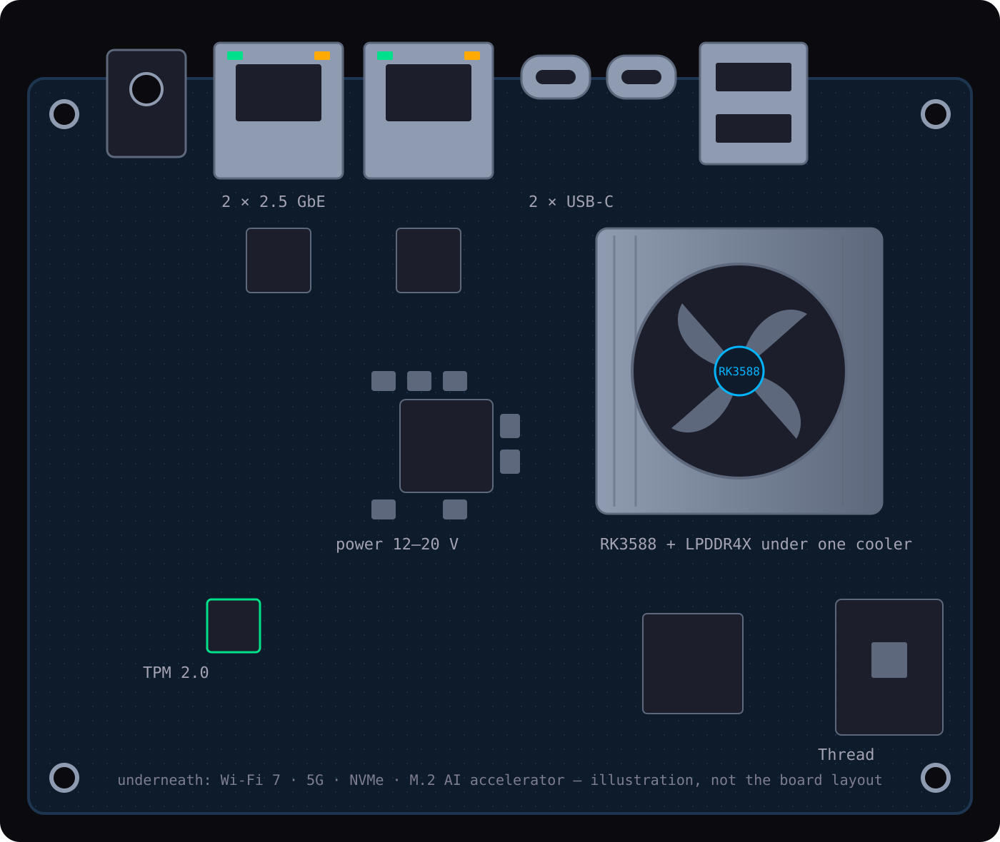

<p align="center">
  
</p>

<h1 align="center">One Node's Detection → Everyone's Protection</h1>

<p align="center">
  <strong>One security operating system. One shared evidence model. Multiple operator workspaces.</strong>
</p>

<p align="center">
  Current release: <a href="docs/releases/v0.0-26.md"><strong>HookProbe OS v0.0-26 "Zamolxis"</strong></a> (pre-release)
</p>

<p align="center">
  <a href="https://github.com/hookprobe/hookprobe/stargazers"></a>
  <a href="https://github.com/hookprobe/hookprobe/network/members"></a>
  <a href="LICENSE"></a>
</p>

<p align="center">
  <a href="#what-hookprobe-can-do">What it can do</a> ·
  <a href="#system-architecture">Architecture</a> ·
  <a href="#try-hookprobe">Try HookProbe</a> ·
  <a href="#hardware-roadmap-the-hookprobe-board">Hardware roadmap</a> ·
  <a href="CONTRIBUTING.md">Contribute</a>
</p>

---

## What HookProbe can do

HookProbe OS is designed to put practical security within reach: a local-first security operating
system that can observe a network, identify suspicious activity, connect detections to evidence,
and give an operator one place to understand and control what happens next.

**The operating system is HookProbe OS. SOC is its default workspace. Hardware only unlocks capabilities.**

### Manage it one way, from any client

Every management client talks to the device through **one management interface** (the management
ABI), and one component inside the kernel, **`cfgd`**, is the only thing that writes configuration.

```text
   hsh (native shell, EL0)     Mission Control (web UI)     AI copilot (tools)
              └──────────────────────┼──────────────────────┘
                          management ABI
                                     │
                     cfgd — the single configuration writer
            authenticate · authorize · validate · stage · trial · commit / revert
```

- **`hsh`** is HookProbe's own management shell, built into the kernel. It is not Bash, BusyBox or a
  Linux shell. It runs as an isolated user-mode component, sees the same numbers Mission Control
  does, and cannot reach kernel internals. Its read commands pass on CM5
  ([batch 59–63](docs/design/metal-evidence/20261111-batch59-63.md)). Production access was decided on
  2026-11-12: a console in Mission Control over the owner's HTTPS session; every command that changes
  something needs a request signed off-device with the owner's key, so the console itself carries no
  authority. That signed path is QEMU-tested only (metal pending); no serial-console access is built.
  See the [`hsh` design](docs/design/hsh-native-management-shell.md) and the
  [signed request format](docs/design/mgmt-envelope-api.md).
- **Mission Control** is the web UI, served by the device itself. It is a client of the same
  interface, with nothing UI-specific on the device.
- **Configuration is signed, not trusted.** The owner holds a signing key (in the browser, with an
  encrypted backup) and enrolls it as the device's owner key; after that the device accepts only
  configuration signed with it. Internet, Wi-Fi and firewall settings travel as one signed bundle,
  bound to the device. A bundle starts as a **trial**: the device keeps it once the internet works,
  or goes back to the last good settings by itself (proven on CM5 after a reboot,
  [batch 59–63](docs/design/metal-evidence/20261111-batch59-63.md)). Changes to how you reach the
  device must be confirmed by the owner, with a request signed by the owner's key.
- Built on main 2026-11-12, **QEMU-tested only, not yet run on CM5**: stored configuration (including
  the Wi-Fi and PPPoE passwords) encrypted at rest with a device-bound key, and firewall, internet and
  Wi-Fi changes applied live, without a reboot, with the same trial and automatic revert
  ([design and status](docs/design/heqk-sealed-config-live-apply.md)).
- Still to come: passkey signing.

Details: [ADR 0058](docs/adr/0058-owner-signed-runtime-config.md) (owner-signed configuration),
[ADR 0059](docs/adr/0059-secure-configuration-management.md) (secure configuration management) and
the [Mission Control UI requirements](docs/design/mission-control-ui-requirements.md).

### Protect locally

Inspect and respond at the device, without making cloud connectivity, an account, or an AI service a
precondition for local protection. Detection is designed to be observable by default; enforcement
is a separate, policy-controlled decision that protects legitimate traffic and management access.

### Turn signals into an understandable story

Bring supported network and device signals into a shared evidence model. Link a detection to its
flows, affected assets, related events, and response so an operator can move from “something
happened” to “why it matters” without jumping between disconnected tools.

### Operate one system through many workspaces

Mission Control is the operator's home. Observe, Detect, Investigate, Protect, Network, Intelligence,
and other workspaces are views over shared system state—not separate products with separate data.
The same evidence can support a responder's investigation and an operator's broader view.

### Make security decisions reviewable

State an outcome instead of hand-editing a pile of device settings. AEGIS is designed to reconcile
authorized desired state deterministically; an optional AI planner can help turn intent into an
explainable plan. The kernel—not an AI model—remains responsible for enforcing authorized policy.

### Grow from one device to a fleet

Start standalone, including in disconnected environments. Add a cloud-linked or self-hosted control
plane when fleet coordination is useful. The longer-term vision is opt-in sharing of validated,
privacy-preserving threat knowledge, so one node's detection can help protect others; a live global
threat-sharing mesh is not a prerequisite for the product.

## System architecture

HookProbe connects local signals to local decisions and operator-visible evidence. Hardware
capabilities shape what a device can do; they do not turn it into a different product.

<p align="center">
  
</p>

<p align="center"><em>One local system, one evidence model, many views. Fleet coordination is additive.</em></p>

| Part of the system | Responsibility |
|---|---|
| **heqk and platform capabilities** | The intended common OS substrate. A platform contributes its hardware port and the capabilities it can safely provide. |
| **Local packet and policy path** | Examines supported traffic and applies an explicit, locally enforceable verdict. It does not depend on a browser, cloud, or model response. |
| **Senzorium** | Observation and telemetry: bring supported signals into a useful, normalized form. |
| **NAPSE, QSecBit, and HYDRA** | Network threat detection, security-posture signals, and threat-intelligence enrichment. |
| **Evidence graph** | Connects assets, events, detections, incidents, and responses so each workspace can follow the same facts. |
| **AEGIS** | Reconciles authorized intent into system state; optional AI assists planning but does not enforce it. |
| **cfgd and the management ABI** | The single writer of device configuration: checks who asks and what is signed, stages a change as a trial, commits it or reverts it. Every management client goes through it. |
| **hsh** | HookProbe's own management shell inside the kernel: a small, deterministic command line over the same management ABI. |
| **Mission Control** | The on-device web experience, with workspaces for understanding and managing the system; a client of the same management ABI. |
| **Optional control plane** | Adds fleet enrollment and coordination without becoming a requirement for local operation. |

These are architectural responsibilities, not a promise that every named service is already a
separate process on every device. The [high-level design](docs/design/hookprobe-high-level-design.md)
explains the product boundaries; the [heqk low-level design](docs/design/heqk-low-level-design.md)
covers the kernel, hardware, and packet path. The current platform and milestone plan is in the
[Build Plan](docs/roadmap/BuildPlan.md).

## The mission

Security should not be a privilege reserved for organizations with large budgets. People should not
have to depend on opaque systems for their safety and data, or face shared threats in isolation.

HookProbe aims to make protection more accessible, understandable, and collaborative. The long-term
vision is that defenders can choose to share validated, privacy-preserving threat knowledge—turning
one node's detection into protection for others.

Read the [HookProbe Manifesto](legacy/v1/MANIFESTO.md) for the project's original mission and values.
Its technical descriptions refer to the earlier V1 implementation; this repository's current
architecture is documented in the designs linked above.

## Hardware roadmap: the HookProbe board

HookProbe OS runs on a Raspberry Pi Compute Module 5 today. Next, we are designing a board of our own: a
security appliance built around the RK3588, with everything a home or small-office gateway needs on one
board.

<p align="center">
  
</p>

| | Raspberry Pi CM5 today | HookProbe board |
|---|---|---|
| Ethernet | 1 GbE + a carrier port | **2 × 2.5 GbE** |
| Device identity | Derived from one-time-programmable fuses | **TPM 2.0 key store** |
| Wi-Fi | Wi-Fi 5, on-module | **Wi-Fi 7 (Qualcomm QCN9274), M.2** |
| Backup internet | — | **5G modem (Sierra Wireless EM9293) + nano-SIM** |
| Local retention | eMMC | **eMMC + NVMe SSD** |
| On-device AI | — | **RK3588 NPU (6 TOPS) + an M.2 slot for an AI accelerator card** |

**Room for AI.** Besides the NPU built into the RK3588, the board has a dedicated **M.2 M-key 2280 slot for an AI
accelerator card** (an NPU card, or an FPGA). Detection and classification models can run on the box with no cloud
call, and the card can be upgraded as accelerators improve. In rev A the slot has one PCIe 3.0 lane and
about 10 W of power. Which cards HookProbe OS supports will be decided on the prototype.

The software doesn't fork for it. The board is one hardware profile, and each part unlocks its
feature in Mission Control once it is proven on real hardware.

**The path.** Each step is a pass/fail test on real hardware:

| Gate | What has to be true | Status |
|---|---|---|
| **H0** | HookProbe OS validated on CM5: long-run soak, thermal and scale tests, independent security sign-off, hardware test gate green | **in progress** |
| **H1** | The kernel's hardware layer separated, so a new board is a profile, not a fork | planned |
| **H2** | HookProbe OS proven on an off-the-shelf RK3588 board, with Wi-Fi 7 and 5G brought up there first | planned |
| **H3** | Our board routed, then reviewed for signal and power integrity | planned |
| **H4** | Prototypes built and measured: both ports, NVMe, TPM, radios, thermal | planned |
| **H5** | Release: reproducible board image, manufacturing package, certified units | planned |

**Where it stands (November 2026).** Rev A schematic and component placement are complete, pass
90 automated design checks, and are [public in this repository](hardware/hookprobe-sbc/). The board is not routed yet and has not been built; there is nothing to
buy. Performance figures will come from prototype measurements.

**Reference material.**
- [ADR 0064: HookProbe hardware program](docs/adr/0064-hookprobe-hardware-program.md): the gates, the driver
  work, the boot chain and root of trust, and the licence.
- [`appliance/hookprobe-sbc/`](appliance/hookprobe-sbc/): how HookProbe OS sees the board and what each part
  unlocks.
- [Build Plan, Track H](docs/roadmap/BuildPlan.md): live status.
- **The design itself: [`hardware/hookprobe-sbc/`](hardware/hookprobe-sbc/)**: schematic (PDF and KiCad), component
  placement, BOM, 3D model, the generator scripts and the validation report. Published as work in progress under
  **CERN-OHL-S-2.0**, with a commercial licence for closed derivatives
  ([`hardware/README.md`](hardware/README.md)). Review it and tell us what you find.

**Help us build it.** We are looking for:
- **Hardware engineers** with RK3588 / LPDDR4X layout experience for routing and signal- and power-integrity
  review (H3), and for prototype bring-up (H4).
- **Kernel and driver developers** for the RK3588 port: PCIe, RTL8125, NVMe, TPM, Qualcomm Wi-Fi 7, 5G (H1–H2),
  and the RK3588 NPU and M.2 AI accelerator cards.
- **Sponsors and funders** for prototype runs, compliance testing and the first production batch.

Sponsor through [GitHub Sponsors](https://github.com/sponsors/hookprobe) or
[Open Collective](https://opencollective.com/hookprobe). To work on the board, fund it or partner with us,
start a thread in [GitHub Discussions](https://github.com/hookprobe/hookprobe/discussions) or email
**qsecbit@hookprobe.com**.

## Try HookProbe

### Explore the dashboard demo

[Open the hosted demo](https://mssp.hookprobe.com/?site=demo-site). It uses simulated data to
illustrate the fleet dashboard; it is not a live security sensor or the on-device operating system.

### Build and explore in QEMU

For the developer environment and prerequisites, see the [heqk setup guide](os/kernel/HACKING.md).
Then run:

```sh
os/kernel/validate.sh
os/kernel/tools/mc-e2e.sh
```

The first command validates implemented kernel phases under QEMU. The second exercises a browser
flow from a test attack through heqk detection to evidence in Mission Control.

To check the Mission Control UI on its own (typecheck plus the behaviour suite, no QEMU needed), or
everything CI runs for it:

```sh
os/mission-control/tests/ui/run.sh
tools/ci/gates.sh g3
```

### Explore the design

- [HookProbe high-level design](docs/design/hookprobe-high-level-design.md)
- [heqk low-level design](docs/design/heqk-low-level-design.md)
- [OS architecture](docs/architecture/Readme.md)
- [Mission Control specification](docs/architecture/MissionControl.md)
- [Mission Control UI layouts and requirements](docs/design/mission-control-ui-requirements.md) (incl. the configuration journey)
- [ADR 0058 — owner-signed configuration on a running device](docs/adr/0058-owner-signed-runtime-config.md)
- [ADR 0059 — secure configuration management (cfgd, signed bundles, trial and revert)](docs/adr/0059-secure-configuration-management.md)
- [`hsh` — the native management shell](docs/design/hsh-native-management-shell.md)
- [CM5 bench acceptance record](docs/design/bench-runbook-prod-mc-2026-11.md)
- [ADR 0064 — HookProbe hardware program (the RK3588 board)](docs/adr/0064-hookprobe-hardware-program.md)
- [Current roadmap and engineering gaps](docs/roadmap/BuildPlan.md)

## Contribute

Code, testing, documentation, and carefully investigated issue reports are welcome.

- Read the [contributing guide](CONTRIBUTING.md).
- Browse [open issues](https://github.com/hookprobe/hookprobe/issues).
- Join [GitHub Discussions](https://github.com/hookprobe/hookprobe/discussions).

Please report vulnerabilities privately using the [security policy](SECURITY.md), not in a public
issue.

## Project growth

Repository stars over time:

<p align="center">
  <a href="https://star-history.com/#hookprobe/hookprobe&Date">
    <picture>
      <source media="(prefers-color-scheme: dark)" srcset="https://api.star-history.com/svg?repos=hookprobe/hookprobe&type=Date&theme=dark" />
      <source media="(prefers-color-scheme: light)" srcset="https://api.star-history.com/svg?repos=hookprobe/hookprobe&type=Date" />
      
    </picture>
  </a>
</p>

## License

All HookProbe software is licensed under **AGPL-3.0-only**, and the hardware designs in
[`hardware/`](hardware/) under **CERN-OHL-S-2.0**; both are also available under a commercial licence.
Third-party components keep their own licences. See [LICENSING.md](LICENSING.md) and [LICENSE](LICENSE).
The original HookProbe V1 implementation is preserved in [`legacy/v1/`](legacy/v1/).

<p align="center">
  <strong>HookProbe OS</strong><br/>
  Local protection. Shared intelligence. Evidence-driven security.<br/>
  <a href="https://hookprobe.com/">hookprobe.com</a> ·
  <a href="https://github.com/sponsors/hookprobe">Sponsor development</a>
</p>
