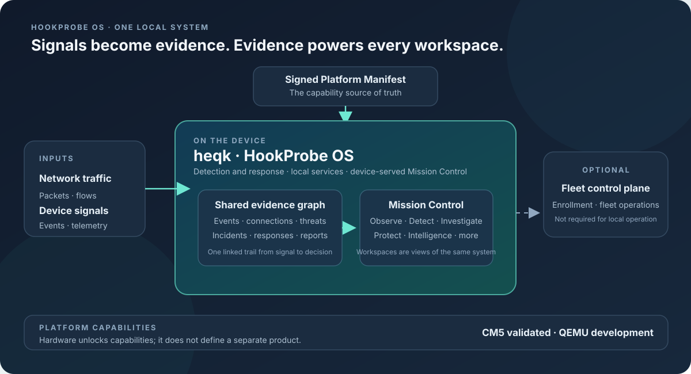

<p align="center">
  
</p>

<h1 align="center">One Node's Detection → Everyone's Protection</h1>

<p align="center">
  <strong>HookProbe OS is the operating system. SOC is its default workspace. Hardware only unlocks capabilities.</strong>
</p>

<p align="center">
  A local-first security OS built on heqk, a Rust capability microkernel. It brings network
  signals, detections, and evidence into Mission Control on the device.
</p>

<p align="center">
  <a href="https://github.com/hookprobe/hookprobe/stargazers"></a>
  <a href="https://github.com/hookprobe/hookprobe/network/members"></a>
  <a href="LICENSE"></a>
</p>

<p align="center">
  <a href="#try-hookprobe">Try HookProbe</a> ·
  <a href="docs/roadmap/BuildPlan.md">Project status</a> ·
  <a href="CONTRIBUTING.md">Contribute</a>
</p>

---

> **Development status:** HookProbe OS is under active development; a public signed CM5 image is
> not yet available. See the validation record and developer paths below.

## The mission behind the system

Security should not be a privilege reserved for organizations with large budgets. People should
not have to trust opaque systems with their safety and data, or face shared threats in isolation.
HookProbe exists to make protection more accessible, understandable, and collaborative.

Our long-term vision is for defenders to share validated, privacy-preserving threat knowledge by
choice—so one node's detection can help protect others. A live global mesh or instant threat-sharing
service is **not** available today; the current work is building the local-first OS and security
foundation for that future.

For the values and broader vision behind the project, read the
[HookProbe Manifesto](legacy/v1/MANIFESTO.md). Its technical descriptions refer to the earlier V1
implementation; the current architecture and implementation status are documented below.

## What HookProbe is

HookProbe OS brings network observation, detection, evidence, and operator controls together in one
system. It can operate locally without an account or cloud connection; enrolling with a control
plane is optional for fleet operations.

The design is **one OS, one evidence model, many workspaces**. Hardware-specific capabilities are
described by a platform manifest, rather than exposed as separate products. Detection is designed
to be observable by default, with enforcement constrained to confirmed attacks and resource
exhaustion.

For the system-wide design—from HookProbe's mission and operating model to its shared services,
trust boundaries, and platform strategy—read the
[HookProbe high-level design](docs/design/hookprobe-high-level-design.md).

## Inside HookProbe OS

<p align="center">
  
</p>

<p align="center"><em>Signals become evidence; the same evidence powers each operator view.</em></p>

The heqk microkernel owns the on-device packet path and hosts the local security system, including
Mission Control. The diagram shows the intended product model; the status below distinguishes
validated behavior from work that is not yet publicly released.

Read the [OS architecture](docs/architecture/Readme.md) and
[Mission Control specification](docs/architecture/MissionControl.md) for the full design.
For the kernel, device, and packet-path details, see the
[heqk low-level design](docs/design/heqk-low-level-design.md). It distinguishes the conceptual
target architecture from the portions validated on QEMU and CM5.

## What has been demonstrated

| Area | Current evidence |
|---|---|
| **CM5 boot and Mission Control** | A bench image booted without Linux, served Mission Control, and accepted owner-key sign-in. |
| **Detection and response** | A live test attack was dropped and its detection appeared in the browser during the CM5 acceptance run. |
| **QEMU development** | The kernel validation gates and browser end-to-end flow can be run without physical hardware. |
| **Public device image** | Not available yet. The CM5 result used development signing keys, not production release keys. |

See the [CM5 bench acceptance record](docs/design/bench-runbook-prod-mc-2026-11.md) and the
[roadmap](docs/roadmap/BuildPlan.md) for scope and status.

## Try HookProbe

### Explore the dashboard demo

[Open the hosted demo](https://mssp.hookprobe.com/?site=demo-site). It uses simulated data to show
the fleet dashboard; it is **not** the on-device OS or a live security sensor.

### Build and validate in QEMU

Install the project's pinned Rust toolchain and `qemu-system-aarch64`. The browser test also needs
Node.js and Playwright Chromium. See the [developer setup guide](os/kernel/HACKING.md), then run:

```sh
os/kernel/validate.sh
os/kernel/tools/mc-e2e.sh
```

The first command runs the QEMU phase gates. The second exercises the browser flow from test attack
through heqk detection to evidence in Mission Control.

### Run on CM5 hardware

See [Getting started](docs/getting-started/README.md) for hardware requirements and the
developer-image procedure.

## Contribute

Code, testing, documentation, and careful issue reports are welcome. Read the
[contributing guide](CONTRIBUTING.md), then browse
[open issues](https://github.com/hookprobe/hookprobe/issues) or
[discussions](https://github.com/hookprobe/hookprobe/discussions).

Please report vulnerabilities privately using the [security policy](SECURITY.md), not in a public
issue.

## License and further reading

Use HookProbe for personal or internal business protection under AGPL-3.0. Offering it as a
service to others may require a commercial license; see [LICENSING.md](LICENSING.md) and
[LICENSE](LICENSE). The original HookProbe V1 implementation is preserved in
[`legacy/v1/`](legacy/v1/). Visit [hookprobe.com](https://hookprobe.com) or
[sponsor development](https://github.com/sponsors/hookprobe).

## Project growth

Repository stars over time:

<p align="center">
  <a href="https://star-history.com/#hookprobe/hookprobe&Date">
    <picture>
      <source media="(prefers-color-scheme: dark)" srcset="https://api.star-history.com/svg?repos=hookprobe/hookprobe&type=Date&theme=dark" />
      <source media="(prefers-color-scheme: light)" srcset="https://api.star-history.com/svg?repos=hookprobe/hookprobe&type=Date" />
      
    </picture>
  </a>
</p>
