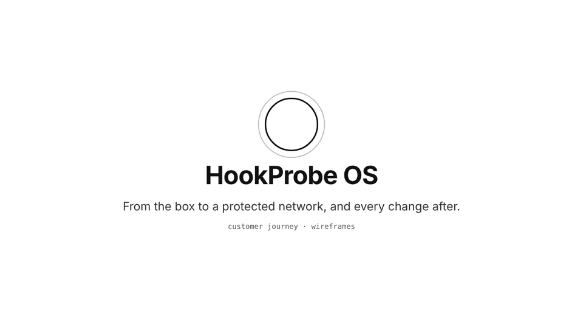
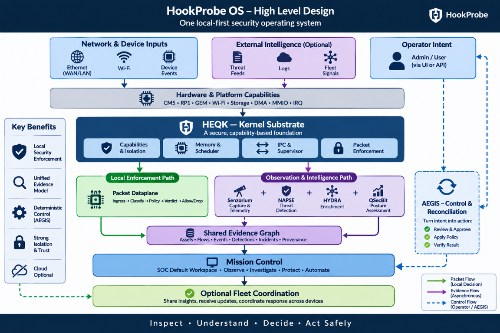

<p align="center">
  
</p>

<h1 align="center">One Node's Detection → Everyone's Protection</h1>

<p align="center">
  <strong>One security operating system. One shared evidence model. Multiple operator workspaces.</strong>
</p>

<p align="center">
  <a href="https://github.com/hookprobe/hookprobe/stargazers"></a>
  <a href="https://github.com/hookprobe/hookprobe/network/members"></a>
  <a href="LICENSE"></a>
</p>

<p align="center">
  <a href="#what-hookprobe-can-do">What it can do</a> ·
  <a href="#system-architecture">Architecture</a> ·
  <a href="#try-hookprobe">Try HookProbe</a> ·
  <a href="CONTRIBUTING.md">Contribute</a>
</p>

---

## What HookProbe can do

HookProbe OS is designed to put practical security within reach: a local-first security operating
system that can observe a network, identify suspicious activity, connect detections to evidence,
and give an operator one place to understand and control what happens next.

**The operating system is HookProbe OS. SOC is its default workspace. Hardware only unlocks capabilities.**

<p align="center">
  
</p>

<p align="center"><em>From the box to a protected network, and every change after: the customer journey in the team's wireframes.</em></p>

Where that journey stands in the code: the per-device setup Wi-Fi, the calm Home screen, zones as
permanent owner rules, incident stories, and the Advanced editors that build and sign WAN / Wi-Fi /
firewall files in the browser are built, and so is the three-question first-run setup that signs
your internet and Wi-Fi settings. Uploading those signed files to a running device (until then they
go on the boot card) and passkey signing are in progress — see the
[configuration journey](docs/design/mission-control-ui-requirements.md#configuration-journey-from-flash-to-daily-use)
and [ADR 0058](docs/adr/0058-owner-signed-runtime-config.md).

### Protect locally

Inspect and respond at the device, without making cloud connectivity, an account, or an AI service a
precondition for local protection. Detection is designed to be observable by default; enforcement
is a separate, policy-controlled decision that protects legitimate traffic and management access.

### Turn signals into an understandable story

Bring supported network and device signals into a shared evidence model. Link a detection to its
flows, affected assets, related events, and response so an operator can move from “something
happened” to “why it matters” without jumping between disconnected tools.

### Operate one system through many workspaces

Mission Control is the operator's home. Observe, Detect, Investigate, Protect, Network, Intelligence,
and other workspaces are views over shared system state—not separate products with separate data.
The same evidence can support a responder's investigation and an operator's broader view.

### Make security decisions reviewable

State an outcome instead of hand-editing a pile of device settings. AEGIS is designed to reconcile
authorized desired state deterministically; an optional AI planner can help turn intent into an
explainable plan. The kernel—not an AI model—remains responsible for enforcing authorized policy.

### Grow from one device to a fleet

Start standalone, including in disconnected environments. Add a cloud-linked or self-hosted control
plane when fleet coordination is useful. The longer-term vision is opt-in sharing of validated,
privacy-preserving threat knowledge, so one node's detection can help protect others; a live global
threat-sharing mesh is not a prerequisite for the product.

## System architecture

HookProbe connects local signals to local decisions and operator-visible evidence. Hardware
capabilities shape what a device can do; they do not turn it into a different product.

<p align="center">
  
</p>

<p align="center"><em>One local system, one evidence model, many views. Fleet coordination is additive.</em></p>

| Part of the system | Responsibility |
|---|---|
| **heqk and platform capabilities** | The intended common OS substrate. A platform contributes its hardware port and the capabilities it can safely provide. |
| **Local packet and policy path** | Examines supported traffic and applies an explicit, locally enforceable verdict. It does not depend on a browser, cloud, or model response. |
| **Senzorium** | Observation and telemetry: bring supported signals into a useful, normalized form. |
| **NAPSE, QSecBit, and HYDRA** | Network threat detection, security-posture signals, and threat-intelligence enrichment. |
| **Evidence graph** | Connects assets, events, detections, incidents, and responses so each workspace can follow the same facts. |
| **AEGIS** | Reconciles authorized intent into system state; optional AI assists planning but does not enforce it. |
| **Mission Control** | The on-device operator experience, with workspaces for understanding and managing the system. |
| **Optional control plane** | Adds fleet enrollment and coordination without becoming a requirement for local operation. |

These are architectural responsibilities, not a promise that every named service is already a
separate process on every device. The [high-level design](docs/design/hookprobe-high-level-design.md)
explains the product boundaries; the [heqk low-level design](docs/design/heqk-low-level-design.md)
covers the kernel, hardware, and packet path. The current platform and milestone plan is in the
[Build Plan](docs/roadmap/BuildPlan.md).

## The mission

Security should not be a privilege reserved for organizations with large budgets. People should not
have to depend on opaque systems for their safety and data, or face shared threats in isolation.

HookProbe aims to make protection more accessible, understandable, and collaborative. The long-term
vision is that defenders can choose to share validated, privacy-preserving threat knowledge—turning
one node's detection into protection for others.

Read the [HookProbe Manifesto](legacy/v1/MANIFESTO.md) for the project's original mission and values.
Its technical descriptions refer to the earlier V1 implementation; this repository's current
architecture is documented in the designs linked above.

## Try HookProbe

### Explore the dashboard demo

[Open the hosted demo](https://mssp.hookprobe.com/?site=demo-site). It uses simulated data to
illustrate the fleet dashboard; it is not a live security sensor or the on-device operating system.

### Build and explore in QEMU

For the developer environment and prerequisites, see the [heqk setup guide](os/kernel/HACKING.md).
Then run:

```sh
os/kernel/validate.sh
os/kernel/tools/mc-e2e.sh
```

The first command validates implemented kernel phases under QEMU. The second exercises a browser
flow from a test attack through heqk detection to evidence in Mission Control.

To check the Mission Control UI on its own (typecheck plus the behaviour suite, no QEMU needed), or
everything CI runs for it:

```sh
os/mission-control/tests/ui/run.sh
tools/ci/gates.sh g3
```

### Explore the design

- [HookProbe high-level design](docs/design/hookprobe-high-level-design.md)
- [heqk low-level design](docs/design/heqk-low-level-design.md)
- [OS architecture](docs/architecture/Readme.md)
- [Mission Control specification](docs/architecture/MissionControl.md)
- [Mission Control UI layouts and requirements](docs/design/mission-control-ui-requirements.md) (incl. the configuration journey)
- [ADR 0058 — owner-signed configuration on a running device](docs/adr/0058-owner-signed-runtime-config.md)
- [CM5 bench acceptance record](docs/design/bench-runbook-prod-mc-2026-11.md)
- [Current roadmap and engineering gaps](docs/roadmap/BuildPlan.md)

## Contribute

Code, testing, documentation, and carefully investigated issue reports are welcome.

- Read the [contributing guide](CONTRIBUTING.md).
- Browse [open issues](https://github.com/hookprobe/hookprobe/issues).
- Join [GitHub Discussions](https://github.com/hookprobe/hookprobe/discussions).

Please report vulnerabilities privately using the [security policy](SECURITY.md), not in a public
issue.

## Project growth

Repository stars over time:

<p align="center">
  <a href="https://star-history.com/#hookprobe/hookprobe&Date">
    <picture>
      <source media="(prefers-color-scheme: dark)" srcset="https://api.star-history.com/svg?repos=hookprobe/hookprobe&type=Date&theme=dark" />
      <source media="(prefers-color-scheme: light)" srcset="https://api.star-history.com/svg?repos=hookprobe/hookprobe&type=Date" />
      
    </picture>
  </a>
</p>

## License

HookProbe is licensed under **AGPL-3.0**. Offering it as a service to others may require a commercial
license; see [LICENSING.md](LICENSING.md) and [LICENSE](LICENSE). The original HookProbe V1
implementation is preserved in [`legacy/v1/`](legacy/v1/).

<p align="center">
  <strong>HookProbe OS</strong><br/>
  Local protection. Shared intelligence. Evidence-driven security.<br/>
  <a href="https://hookprobe.com/">hookprobe.com</a> ·
  <a href="https://github.com/sponsors/hookprobe">Sponsor development</a>
</p>
