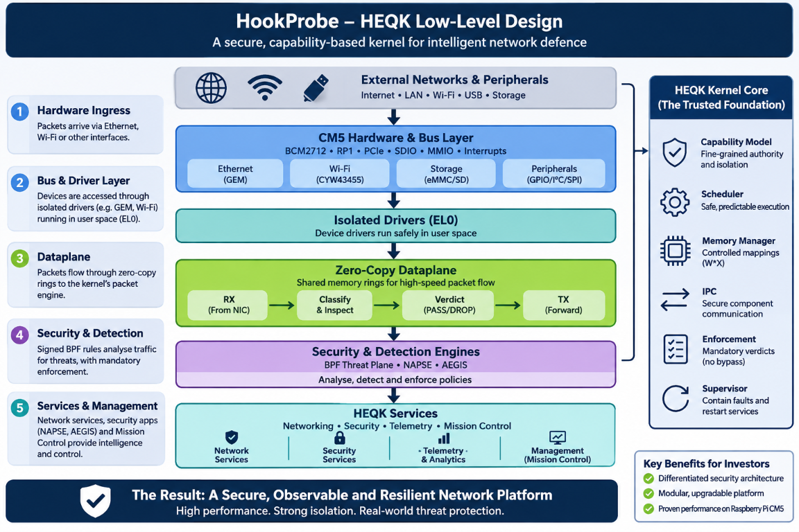

# heqk — Low-Level Design

> **Core rule:** the kernel owns authority and the mandatory verdict boundary; drivers own hardware within granted authority; services own interpretation and operator-facing workflows.

**Status:** Architecture and implementation map. This document distinguishes current evidence from the intended decomposition. It is not a claim that the full diagram below is implemented or released.

**Current as of:** 2026-11-08. See [ADR 0047](../adr/0047-heqk-everywhere-on-device-mission-control.md) for product scope, [ADR 0044](../adr/0044-zero-linux-rpi-native-cm5.md) for the heqk maturity honesty floor, and the [living heqk gap list](heqk-remaining-gaps.md) for changing work status.

## 1. Purpose and scope

This design describes how the HookProbe OS product is realized inside heqk: boot and trust, memory and capabilities, device access, packet processing, detection, services, Mission Control, and failure handling.

The supplied illustration is included as a **conceptual target view**. In particular, its isolated-driver, zero-copy multi-process, NAPSE/AEGIS service, and broad enforcement boxes should not be read as proof that all those process boundaries or integrations are present in the current kernel image.



*Supplied architecture illustration. It is a design view, not a validation artifact; its “proven performance” wording is not a measured performance claim.*

The implementation baseline is a Rust `no_std` aarch64 kernel with a QEMU `virt` validation target and CM5 bring-up. ADR 0047 makes heqk the destination substrate on all platforms, but only platforms with their own implementation and gates can be called supported.

## 2. Design rules

1. **Authority is explicit:** resource access comes from kernel-mediated capabilities, not process names, root conventions, or possession of an address.
2. **One verdict boundary:** traffic enforcement has a single authoritative, fail-closed decision point. A driver, management API, or AI planner cannot bypass it.
3. **Bounded common path:** interrupts, packet work, IPC, queues, and event recording have finite work and explicit overflow behavior.
4. **Control is not bulk data:** use IPC for lifecycle and control; use bounded shared-memory/buffer ownership for high-volume packet data when that path is implemented.
5. **Observe is not enforce:** detection and enforcement are distinct. A rule firing alone does not justify dropping customer traffic.
6. **Single-core contract until replaced:** current safety arguments rely on one core and non-reentrant state mutation. SMP is a new design and verification effort, not a safe tuning switch.
7. **Status follows evidence:** source presence, QEMU proof, a CM5 bench run, and a repeatable platform gate are different evidence levels.

## 3. Hardware and bus model

On CM5, the logical hardware path includes the BCM2712 CPU/memory/MMU/GIC and the RP1 southbridge reached over PCIe. The RP1 provides Ethernet GEM and peripheral functions. Wi-Fi and storage use the BCM2712-side SDHCI paths (SDIO to CYW43455 and eMMC/SD storage). Other targets expose different buses and devices through their port-specific HAL and driver layer.

| Lane | Low-level purpose | Boundary to preserve |
|---|---|---|
| CPU ↔ MMIO | Device control and status registers | Map only the required register range; validate access and ordering. |
| Device ↔ memory (DMA) | Frame and descriptor transfer | Constrain DMA to explicitly assigned memory; define cache/coherency and ownership rules. |
| Device ↔ interrupt controller | Notify work or fault | Acknowledge and bound interrupt work; defer packet parsing and expensive processing. |
| Shared memory | Packet descriptors, buffers, and event records | Define one owner at a time, memory ordering, bounded queue depth, and overflow behavior. |
| Capability IPC | Configuration, lifecycle, faults, and policy requests | Authenticate by granted endpoint/notification authority; do not send every packet through synchronous IPC. |

This table is a contract, not evidence that every bus on every board is operational. A driver file does not establish a validated hardware datapath.

## 4. Boot and trust boundary

The boot path is platform-specific but must converge on the same invariants:

```text
platform firmware / boot selection
  → select boot slot and kernel artifact
  → validate applicable boot trust and rollback state
  → establish CPU mode, vectors, initial mappings, stack, and console
  → initialize kernel memory, scheduler, and authority roots
  → initialize only the devices and services supported by this image
  → expose authenticated local management after the enforcement path is ready
```

Boot signing, image construction, A/B selection, anti-rollback persistence, and recovery are governed by [heqk signing identity](heqk-signing-identity.md), [heqk persistence](heqk-persistence.md), and the platform build/release gates. A test key, a successful compile, or a bench boot is not a production release signature.

**Required invariant:** recovery from a bad update must select a known-good bootable state without weakening the verification policy. Platform-specific persistence must not be described as durable anti-rollback until its storage and attacker model are validated.

## 5. Kernel core and authority model

The kernel TCB is responsible for:

- exception entry, privilege transitions, and architecture/HAL boundary;
- physical and virtual memory management, safe mappings, and W^X enforcement;
- thread control and scheduling under the current concurrency model;
- capability creation, lookup, rights checks, delegation, and revocation;
- synchronous control IPC and asynchronous notifications;
- bounded packet-engine and verdict responsibilities required for enforcement;
- fault containment and lifecycle hooks used by the supervisor;
- minimal trusted event/fault accounting.

### 5.1 Capabilities and isolation

The intended authority chain is:

```text
boot authority
  → root capability space
  → narrowly typed objects / frames / endpoints / notifications
  → delegated, rights-limited capabilities
  → revocation of derived authority and mappings on teardown
```

For each EL0 server, the design must enumerate its capability set: address-space frames, endpoints, notifications, IRQ authority, device-register windows, and DMA/shared-buffer regions. The server receives no ambient access to unrelated kernel memory or hardware. Reused memory must be scrubbed and executable memory must maintain W^X.

The repo has capability primitives and validation work, but the complete end-to-end integration of capabilities with every MMIO mapping, IRQ, and DMA grant is a distinct security acceptance criterion. Do not equate a capability table or EL0 transition with full device isolation.

### 5.2 Scheduling and concurrency

The current [kernel architecture](../../os/kernel/ARCHITECTURE.md) defines a **single-core, non-reentrant** invariant for state-mutating kernel paths. Interrupt handling and SPSC state depend on that invariant. The implementation must remain within that contract unless an explicit SMP design provides per-core ownership, synchronization, memory-ordering rules, interrupt routing, and new adversarial tests.

The design goal is bounded and predictable execution, not a blanket hard-real-time guarantee. Any future latency claim requires a defined workload, measurement method, platform, tail-latency target, and proof that detection and management cannot starve the packet path.

## 6. Device and driver model

The target driver server owns only a specific device function and its buffers. Its conceptual lifecycle is:

```text
trusted bootstrap enumerates / initializes device
  → grants a bounded device, IRQ, and buffer authority set
  → driver services the device from an isolated execution context
  → driver publishes validated work / reports a fault
  → supervisor revokes authority and contains or restarts the server
```

During bring-up, privileged code may perform hardware setup before the driver is fully isolated. The low-level design must show this transitional bootstrap explicitly instead of drawing every driver as already running in EL0.

| Device/path | Design role | Evidence rule |
|---|---|---|
| RP1 GEM Ethernet | CM5 packet ingress/egress and primary datapath | Distinguish QEMU virtio proof from GEM silicon observations and repeatable metal gates. |
| CYW43455 Wi-Fi | SDIO control/data and supported wireless modes | Firmware/control progress does not imply association, AP, or data-path parity. |
| eMMC / SDHCI | Persistent boot state, configuration, and retention | Read path, write path, filesystem, sealing, and rollback each need their own gate. |
| Secondary Ethernet (e.g. RTL8111) | Additional interface | Source or prepared driver is not proof of physical port operation. |
| GPIO / I²C / SPI / UART | Platform and peripheral control | Keep mappings and pin/clock effects scoped to explicit authority. |
| VirtIO | QEMU device path | Useful for deterministic development; not hardware evidence. |

## 7. Packet dataplane

### 7.1 Ownership and execution

On CM5, a representative Ethernet path is:

```text
PHY / GEM
  → hardware RX descriptor and DMA buffer
  → bounded ingress validation
  → packet parsing and security classification
  → one explicit verdict
      ├─ PASS / permitted action → transmit or forward
      └─ DROP / confirmed action → do not transmit
  → recycle buffer and asynchronously publish telemetry
```

The low-level implementation must track hardware descriptor rings separately from software packet/event queues. For each buffer, document its owner, allowed readers/writers, transition, length bounds, and recycle condition. Hardware must not overwrite a buffer while software owns it; a transmitter must not reuse it until completion.

The current heqk evidence includes packet-engine, classification, and verdict validation; the exact boundaries are not yet equivalent to the fully decomposed multi-process architecture in the illustration. [ADR 0044](../adr/0044-zero-linux-rpi-native-cm5.md) explicitly calls out that detection/TCP stack/drivers can still be linked into one kernel image.

### 7.2 Zero-copy ring target

The target ring design in [`ZEROCOPY_IPC_RING.md`](../../os/kernel/ZEROCOPY_IPC_RING.md) separates control state, descriptors, and payload memory. SPSC producer/consumer indices transfer ownership; notifications wake an idle consumer; bulk data does not traverse a synchronous syscall per packet. Inline operation additionally needs explicit RX/free/TX/completion ownership and back-pressure semantics.

Treat that ring as a target contract unless a specific gate proves the exact producer/consumer topology on the relevant platform. The conceptual image's “zero-copy dataplane” label must not be interpreted as a complete production ring implementation.

### 7.3 Interrupt and back-pressure behavior

Interrupt handlers should acknowledge/mask as needed, record bounded state, and notify a worker. Packet parsing, rule evaluation, network service work, and telemetry enrichment do not belong in an unbounded interrupt handler.

The edge design favors interrupt-assisted bounded polling and sleeping when idle. Under sustained load, any adaptive polling or core pinning policy must preserve explicit CPU budgets for enforcement and must be measured on target hardware. Queue saturation must define whether packets fail open or closed by interface and operator policy; telemetry saturation must never fabricate a successful action or stall the verdict path.

## 8. Detection and enforcement

The portable detection contract is RFC 9669 BPF bytecode, not Linux eBPF/XDP. A detection artifact's path is:

```text
signed rule / module
  → signature and policy validation
  → bounds and safety verification
  → interpreter or W^X JIT execution
  → explicit Observe / RateLimit / Quarantine / FrameDrop decision as permitted
  → evidence and counters
```

The interpreter is the bounded execution baseline; JIT execution is allowed only with memory-protection and verifier invariants intact. Detection output and enforcement policy must stay separate: a match can be an observation, while destructive action requires the policy's defined confidence and evidence. Allowlisted management traffic and legitimate customer traffic retain their safety floor.

The BPF verifier/JIT and packet-engine architecture have their own documents and gates: [BPF threat plane](../../os/kernel/BPF_THREAT_PLANE.md), [detection parity](heqk-detection-parity.md), and the separation requirements in [ADR 0023](../adr/0023-enforcement-separation.md).

The target design separates high-level intelligence from mandatory packet enforcement. NAPSE, AEGIS, QSecBit, and HYDRA are product responsibilities; their names do not prove that the corresponding service is isolated, fully integrated, or running on every heqk target.

## 9. Services and management plane

The device needs a bounded stack from the packet interface to local management: link and address configuration, network protocols, authenticated API/TLS, and a static Mission Control UI. The UI/API is served by heqk on the device under ADR 0047; it is not a Linux dependency.

Keep three classes of work distinct:

| Plane | Carries | Must not do |
|---|---|---|
| **Data plane** | Frames, descriptors, verdicts, forwarding | Wait for cloud, AI, database, or browser work. |
| **Control plane** | Policy, configuration, lifecycle, local API requests | Bypass capability checks or issue an unscoped hardware command. |
| **Telemetry plane** | Events, faults, counters, evidence links, optional export | Block enforcement or report missing data as success. |

The current status is partial and specific: the living gap list records on-device Mission Control/API slices and TLS in EL0 while HTTP parsing remains in EL1; several network-control protocols and full service separation remain open. Some workspaces intentionally show clearly labeled sample data where a device API does not provide the real backing service.

## 10. Fault handling, restart, and recovery

Every component boundary needs a failure contract:

- **Driver fault:** stop new DMA, contain the task, revoke device and buffer authority, record the fault, restart only if reset and buffer ownership are known safe.
- **Detection fault:** do not silently accept a stale or malformed verdict. Apply the interface's configured fail-open/fail-closed behavior and emit an explicit health event.
- **Queue overflow:** account for loss and preserve enforcement; never silently present incomplete telemetry as complete.
- **Service/API failure:** keep the packet path independent and expose degraded local state through available channels.
- **Bad image or policy signature:** fail closed for the protected artifact and retain the prior valid boot/policy state when the platform's recovery mechanism supports it.
- **Watchdog / boot failure:** use platform recovery and A/B semantics only where those paths are implemented and gated.

Restart safety depends on revoking mappings and IRQ/DMA access, not merely killing a thread or clearing a capability slot.

## 11. Implementation and validation matrix

The following is an architectural summary, not a replacement for the [Build Plan](../roadmap/BuildPlan.md) or the date-stamped [heqk gaps list](heqk-remaining-gaps.md).

| Area | Design intent | Evidence/status discipline |
|---|---|---|
| Boot, exception vectors, MMU, kernel phases | Small Rust capability microkernel | `validate.sh` proves implemented markers under QEMU; it is not a CM5 or release gate. |
| Scheduler, EL0, IPC, capability objects | Isolated, bounded component substrate | Test each primitive and separately gate actual resource authority and revocation on hardware. |
| RP1 GEM packet path | Real-device ingress, classification, and permitted forwarding/drop | Cite a reproducible CM5 bench/gate; do not transfer QEMU virtio results to GEM. |
| Driver separation | EL0, narrow MMIO/IRQ/DMA grants, supervisor restart | Transitional privileged setup and partial EL0 work must remain labeled until end-to-end capability enforcement is proven. |
| Zero-copy shared rings | Multi-component bounded packet transport | A design document is not a production implementation; gate ownership, memory ordering, saturation, and recovery. |
| BPF plane | Verified portable rules; interpreter and protected JIT | Measure rule parity and security separation on each target; do not conflate Linux eBPF with RFC 9669. |
| Wasm host | Signed modules behind an EL0 boundary | A small real Wasmi fixture is not the full production detection catalogue or service parity. |
| Network / HTTP / TLS | Local control plane independent of cloud | The gap list identifies protocol and privilege-boundary work still open. |
| Mission Control | UI and API served by the device | A bench browser flow proves that path for that image and scope, not every workspace or platform. |
| Storage, OTA, rollback | Durable local state and recoverable updates | Separate read/write, sealing, anti-rollback, power-loss, and signed release gates. |
| Other platforms | Same OS contract on different hardware | Require per-platform boot, HAL/driver, security, performance, and release evidence. |

## 12. Performance and real-time claims

heqk is designed for bounded work on edge hardware. “Real-time” should be qualified as **real-time-inspired / soft real-time** until a published workload and repeatable deadline/latency measurements justify a stronger claim. The current single-core contract, device-service placement, queue pressure, and network load all affect latency.

Performance results must identify board and revision, image/commit, rule set, packet size and traffic mix, direction, duration, CPU and memory pressure, and loss/latency percentiles. Do not infer line rate from a driver existing or from a synthetic QEMU test.

## 13. Open engineering decisions and gates

Before calling the target design production-ready on a platform, close and record:

1. End-to-end capability enforcement for MMIO, IRQ, DMA, and teardown.
2. The exact current-to-target migration of kernel-resident detection and networking into isolated services.
3. Ring ownership, back-pressure, and safe recovery under driver and consumer failure.
4. Detection-catalogue parity and enforcement-separation tests on target hardware.
5. Local Mission Control, TLS/API boundaries, service availability, and honest per-workspace data.
6. Writable storage, retention, update, anti-rollback, and power-loss recovery.
7. Per-platform gates and a release-signed image.

Until then, architecture diagrams remain design aids, not support matrices.

## 14. Related specifications

- [HookProbe high-level design](hookprobe-high-level-design.md) — product, service, operator, and platform architecture.
- [Kernel architecture](../../os/kernel/ARCHITECTURE.md) — core subsystem and concurrency contract.
- [Capability model](../../os/kernel/CAPABILITY_MODEL.md) — authority primitives and invariants.
- [Zero-copy IPC ring](../../os/kernel/ZEROCOPY_IPC_RING.md) — target data-plane ring structure.
- [BPF threat plane](../../os/kernel/BPF_THREAT_PLANE.md) — verifier, interpreter/JIT, and detection boundary.
- [heqk control-plane design](heqk-control-plane.md), [module runtime](heqk-module-runtime.md), [persistence](heqk-persistence.md), and [signing identity](heqk-signing-identity.md).
- [ADR 0044](../adr/0044-zero-linux-rpi-native-cm5.md) and [ADR 0047](../adr/0047-heqk-everywhere-on-device-mission-control.md) — scope and honesty constraints.
