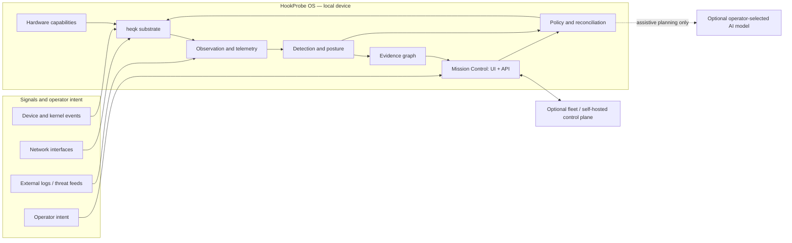

# HookProbe OS — High-Level Design

> **Positioning:** HookProbe OS is the operating system. SOC is its default workspace. Hardware only unlocks capabilities.

**Status:** Product architecture and integration contract. This document explains how the product fits together; it is not a claim that every described service or platform is already implemented.

**Current as of:** 2026-11-08. For the canonical operator experience see [Mission Control](../architecture/MissionControl.md); for the ratified substrate decision see [ADR 0047](../adr/0047-heqk-everywhere-on-device-mission-control.md). Implementation status is tracked in the [Build Plan](../roadmap/BuildPlan.md) and the [heqk gaps report](heqk-remaining-gaps.md).

## 1. Executive view

HookProbe is one local-first security operating system, not a collection of separately operated sensors and dashboards. It observes network and device activity, detects threats, records linked evidence, and exposes investigation and response through Mission Control. The same system can be used as a standalone appliance or enrolled into a fleet; enrollment adds coordination and does not unlock basic local protection.

The product is designed around four operator-visible outcomes:

1. **See:** collect and normalize signals from supported network interfaces and services.
2. **Understand:** relate detections to their source events and affected assets in one evidence model.
3. **Decide:** use deterministic policy and, optionally, an AI planner to propose an understandable plan.
4. **Act safely:** apply authorized policy through a deterministic enforcement path, then verify the result.

The north star is collective defense: one node's validated detection can inform others by choice. A live global threat mesh or automatic cross-customer sharing is not available today and is not required for standalone operation.

## 2. System context



The device is the default trust and availability boundary. Its packet decisions, local evidence, identity, and operator interface must continue to function without a cloud account, remote model, or fleet connection. Remote systems are additive coordination endpoints, not part of the inline enforcement path.

## 3. Product architecture

### 3.1 One substrate, one product

[heqk](../../os/kernel/ARCHITECTURE.md) is the intended product substrate on every platform under ADR 0047. A platform contributes a port, drivers, and a capability profile; it does not become a separate HookProbe product. Linux remains a developer/build host and a transitional image where a heqk port has not yet passed its platform gate. It is not the destination product architecture.

The hardware contract is capability-oriented: software consumes granted capabilities such as a supported interface, storage service, or acceleration path rather than making product decisions from a board name. A signed platform manifest is the intended source of capability truth. Until a capability is implemented and validated on a platform, its presence in a design or source tree does not imply it is available to an operator.

### 3.2 Shared services and named components

The names below identify responsibilities within one system, not separate products. Their target relationships are defined here; their actual implementation and deployment status is tracked separately.

| Responsibility | Product role |
|---|---|
| **Senzorium** | Observation and telemetry collection: capture, flow facts, supported host/device events, and external log ingestion. |
| **NAPSE** | Network threat detection: rules and analysis over supported traffic and normalized events. |
| **QSecBit / QSECBIT** | A composite security and resilience posture signal derived from available evidence and health inputs. |
| **HYDRA** | Threat-intelligence and enrichment: feeds, indicators, and context. It is not the automation/SOAR engine. |
| **AEGIS** | Deterministic local desired-state reconciliation, plus an optional assistive planner that can translate operator intent into a reviewable plan. |
| **Supervisor** | Resolves module requirements and capabilities, manages lifecycle, and contains or restarts supervised components where supported. |
| **Mission Control** | The on-device operator UI and API, presenting workspaces over the common evidence and telemetry model. |

These are not all assumed to be independent processes on every heqk build. In particular, ADR 0044 records that parts of the current heqk datapath, detection, and services are still linked into a single kernel image. Process boundaries are a security and lifecycle goal, not something inferred from component names.

### 3.3 One evidence model, many workspaces

The evidence graph is the shared relationship model for devices, interfaces, flows, detections, incidents, responses, and reports. The Telemetry Fabric describes the path that events take from source through normalization, enrichment, correlation, bounded retention, and search. These are complementary views of the same data, not separate databases per workspace.

Mission Control workspaces are lenses over that shared model: Mission Control, Observe, Detect, Investigate, Protect, Automate, Intelligence, Network/Gateway, Administration, and—when a control-plane connection exists—Customers and Business. A workspace must distinguish real device-backed data from unavailable or sample data; missing integrations must not be represented as successful telemetry.

### 3.4 Intent and AI

The operator states a desired outcome. AEGIS' deterministic reconciler computes and applies authorized changes and checks whether the observed state converges. An optional AI planner may help interpret intent, explain evidence, or propose a diff. The model is selected by the operator and may be remote or local.

The planner is not the enforcement authority. Its output is advisory until reviewed and converted to an allowed desired-state change; the deterministic reconciler and kernel-controlled enforcement boundary remain authoritative. With no model configured—or while offline—the local system must continue to enforce the last valid policy.

## 4. Security and safety properties

The design depends on explicit, testable properties rather than on component labels:

- **Local-first availability:** basic device operation does not require an account, cloud, or LLM.
- **Capability isolation:** hardware and memory authority are granted narrowly and can be withdrawn; a process name or role label alone grants no authority.
- **Observe by default:** detection is not synonymous with blocking. Enforcement follows the ratified separation policy, preserves a management-safety floor, and must not drop legitimate customer traffic on mere suspicion.
- **One authoritative verdict:** a packet must have a bounded, explicit decision path; a driver or AI component cannot silently bypass it.
- **Signed trust boundaries:** release images, modules, and policy artifacts follow the applicable signing and verification contracts. The exact implemented algorithms and key custody are reported by release evidence, not assumed from this overview.
- **Bounded resource use:** queues, work, storage, and retention have explicit limits and visible failure behavior. Telemetry pressure must not stall packet enforcement.
- **Explainability:** an action or recommendation should retain its reason, confidence where applicable, source evidence, and resulting state.

These properties are design constraints, not proof of certification, hard real-time behavior, or a completed production release.

## 5. Operating and deployment modes

| Mode | Local operation | Remote relationship |
|---|---|---|
| **Standalone (default)** | Local security functions, device identity, evidence, and on-device Mission Control. No account is a prerequisite. | None required; air-gapped use is a design goal. |
| **Cloud-linked fleet** | Local operation remains on the device. | Optional enrollment and fleet-level aggregation, policy distribution, and operations. |
| **Self-hosted control plane** | Local operation remains on the device. | An operator-managed endpoint provides fleet coordination without requiring HookProbe's hosted service. |

Remote enrollment must not turn a device into a blind terminal. On loss of connectivity, it should continue under its last valid local policy, report its disconnected/degraded state, and resume synchronization under authenticated policy when connectivity returns.

## 6. Platform strategy and truthful maturity

ADR 0047 ratifies heqk as the destination across QEMU/VM, CM5, RK3588, N100/x86_64, and cloud. That is a product direction, not a statement that all ports exist.

| Scope | What can be said |
|---|---|
| **QEMU aarch64** | The heqk validation script is a QEMU gate and is used to prove implemented kernel phases and the browser end-to-end path. A green run is not a hardware or release gate. |
| **CM5** | Bench evidence exists for heqk boot, networking/security slices, and on-device Mission Control flows. Bench evidence is not equivalent to a reproducible signed public release or full service parity. |
| **Other hardware / cloud** | ADR 0047 target only; each requires its own port, capability report, hardware validation, and release gates before a support claim. |
| **Public image** | The README's current status record says a public signed CM5 image is not yet available. Development bench keys are not release keys. |

For granular, changing status use the [Build Plan](../roadmap/BuildPlan.md), [heqk remaining gaps](heqk-remaining-gaps.md), [heqk-everywhere report](heqk-everywhere-report-2026-10-09.md), and the [CM5 bench acceptance record](bench-runbook-prod-mc-2026-11.md).

## 7. Primary flows and contracts

### Observation to evidence

```text
supported source
  → bounded acquisition
  → parse / normalize with source and timestamp
  → detection or enrichment
  → evidence node(s) and provenance links
  → local retention and Mission Control query
  → optional, policy-controlled fleet export
```

Each event should preserve enough provenance to identify its source, time, device, parser/rule version, and any derived relationship. Enrichment must not overwrite raw evidence. Retention and export policy are explicit; privacy-preserving contribution is opt-in and not presumed to be live.

### Detection to response

```text
packet or event
  → bounded parser / detector
  → explicit verdict and supporting evidence
  → policy check (confidence, scope, allowlist, expiry)
  → deterministic enforcement or observe-only result
  → event recorded and operator-visible
```

For traffic decisions, enforcement is local and synchronous enough to protect the packet path; evidence processing and operator presentation are downstream. User-space orchestration can request a scoped policy action, but it does not receive unmediated hardware authority.

### Intent to verified state

```text
operator intent
  → optional AI interpretation
  → proposed desired-state diff + explanation
  → authorization / operator review as policy requires
  → deterministic reconcile
  → observe and verify
  → evidence of result or explicit failure
```

No silent success fallback is allowed when a capability, service, or remote dependency is absent.

## 8. Interfaces and decision ownership

The exact wire and syscall contracts belong to their interface specifications, not this overview. At the system boundary:

- **Hardware ↔ driver:** device-specific MMIO, interrupt, DMA, and reset contracts.
- **Driver ↔ packet engine:** bounded frame/buffer ownership and ingress metadata.
- **Packet engine ↔ detection:** a validated packet view and a bounded decision contract.
- **Kernel ↔ component:** capability-authorized syscalls, IPC, shared memory, and lifecycle.
- **Device ↔ Mission Control:** authenticated local API and static UI served on-device.
- **Device ↔ fleet:** authenticated optional export/enrollment contract; never a prerequisite for local decisions.

Kernel enforcement and resource authority belong to the kernel. Device ownership belongs to drivers within granted authority. Threat interpretation belongs to detection and intelligence components. Desired-state orchestration belongs to AEGIS. The operator owns approval according to policy.

## 9. Design boundaries and non-goals

- This design does not claim hard real-time guarantees or a measured end-to-end latency bound.
- It does not imply all named components run as isolated processes on heqk today.
- It does not treat the Linux transition tier, its containers, or Linux XDP/eBPF as the destination heqk architecture. heqk's portable detection contract is RFC 9669 BPF, not Linux eBPF.
- It does not promise every protocol, NIC, Wi-Fi mode, workspace, or cloud integration on every platform.
- It does not make global threat sharing automatic or currently available.
- It does not equate source files, a design diagram, a single bench run, or a QEMU pass with production readiness.

## 10. Related specifications

- [OS architecture](../architecture/Readme.md) — canonical OS and substrate decisions.
- [Mission Control](../architecture/MissionControl.md) — operator and workspace contract.
- [heqk low-level design](heqk-low-level-design.md) — hardware, kernel, packet path, trust boundaries, and implementation status.
- [ADR 0043](../adr/0043-heqk-microkernel-substrate.md), [ADR 0044](../adr/0044-zero-linux-rpi-native-cm5.md), and [ADR 0047](../adr/0047-heqk-everywhere-on-device-mission-control.md) — substrate and deployment decisions.
- [Build Plan](../roadmap/BuildPlan.md) — authoritative status and gates.
