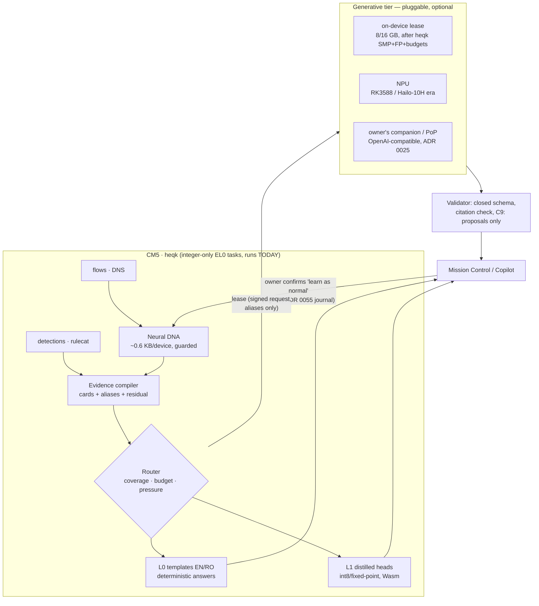

# NEURO_ARCHITECTURE_COMPARISON — Gate 4: five architectures, one value framework

> HookProbe Neuro Engine, Research Gate 001 (2026-11-17). Resource figures are **theoretical** (from
> `data/e-rf1.md`) unless marked otherwise; nothing here was measured on a CM5. Scores are this study's
> judgements, justified line by line below and recomputed by `tools/neuro-research/decision_matrix.py`
> (output: `data/decision-matrix.md`) so they can be challenged and re-run.

## The question each architecture answers differently

*Where does intelligence live when the device has one 32-bit DRAM bus, four A76 cores that belong
mostly to the data plane, and — on heqk today — no SIMD for an EL0 task?*

---

## BASE — Conventional resident LLM

```
telemetry ──(raw rows, truncated)──▶ resident llama-server (≈2B Q4_0, 4 threads) ──▶ free text ──▶ UI
```

| Aspect | Description |
|---|---|
| Memory model | weights resident (~1.1 GiB for a 2B Q4_0) + f16 KV (112 KiB/token for Qwen3-1.7B-class → 224 MiB at 2K) |
| Execution | always loaded; every question → prefill of the raw window → decode |
| Model / runtime | one general instruct model, llama.cpp or Ollama |
| Hardware | ≥ 4 GB SKU; 4 cores; Linux (cannot run on heqk today) |
| Failure behaviour | OOM or swap under pressure; throttling at 80–85 °C; long prompts silently truncated (E-SC1: a truncated raw window kept **0–3%** of incidents) |
| Security boundary | prompt instructions only; free text must be re-validated; raw untrusted strings in context |
| Expected resources | ~1.3 GiB resident; full DRAM bandwidth during decode (~5–10 tok/s for 1.7–2B); prefill of raw windows infeasible (~323K tokens/hour of telemetry) |

**Verdict:** the thing the research gate exists to avoid. It is cheap to build, and that is its only
strength.

## A — Extreme Compact Transformer

```
telemetry ─▶ evidence cards ─▶ resident native-ternary model (BitNet b1.58 2B4T, bitnet.cpp TL1)
          ─▶ KV q8_0 ─▶ constrained JSON ─▶ UI
```

| Aspect | Description |
|---|---|
| Memory model | ~0.75 GiB read per token incl. Q6_K embedding/head (E-RF1); KV 75 KiB/token f16; 4K context ceiling |
| Execution | resident; 2 decode threads, 4 prefill threads |
| Model / runtime | natively low-bit models only (BitNet 2B4T MIT; Falcon-E Falcon licence; Ternary Bonsai Apache via a fork); bitnet.cpp or T-MAC |
| Hardware | 4 GB+; Linux today; heqk needs SMP + FP/SIMD |
| Failure behaviour | as BASE, with ~1.5× more headroom |
| Security boundary | closed decoding possible |
| Expected resources | decode bound ~15 tok/s (vs ~10 for a 1.7B Q4_0) [TH]; T-MAC: BitNet-3B ~11 tok/s on Pi 5 [ARM] |

**Strength:** the best *bytes per token* of any general generator. **Weakness:** a small family of
models, BitNet's general quality below Qwen-class models of similar memory, no Romanian claim, 4K
context, and still a resident model competing for the bus.

## B — Recurrent Edge Intelligence

```
telemetry ─▶ per-device recurrent LM state (RWKV-7 / Mamba hybrid) updated continuously
          ─▶ the same LM answers questions from its carried state ─▶ UI
```

| Aspect | Description |
|---|---|
| Memory model | constant state per sequence (RWKV-7 1.5B ~12 MiB; Granite-4.0-H-1B ~54 MiB) × number of tracked devices/streams + resident weights (~0.7–0.8 GiB) |
| Execution | the LM *consumes the event stream itself* to keep temporal context |
| Model / runtime | RWKV-7, Mamba-2, hybrids in llama.cpp |
| Hardware | 8 GB+ if many streams; continuous CPU + DRAM use |
| Failure behaviour | state drift is opaque — no inspectable baseline; feeding every event through an LM is continuous decode-class bandwidth |
| Security boundary | weak: untrusted telemetry *writes into the model's state* (persistent prompt injection) |
| Expected resources | the highest continuous cost of all options; per-device state in MiB instead of bytes |

**Verdict:** the appealing idea — "a model that remembers the network" — is real, but an LM is the
wrong carrier for it. E-BM1 tracked 60 devices' behaviour in **638 bytes each**, inspectable and
integer-only. An RWKV state is ~12 MiB per stream and is written by untrusted input. Recurrent models
remain candidates for the *generative* tier on quality/licence grounds (Qwen3.5, Granite-H), not as
the memory.

## C — Hybrid Adaptive Intelligence (on-device generative tier)

```
telemetry ─▶ L0 rules ─▶ L1 specialists + Neural DNA ─▶ evidence cards ─▶ router
                                                                   └─▶ L2 compact LLM on device (on demand)
                                                                   └─▶ L3 larger LLM on device (8/16 GB)
```

| Aspect | Description |
|---|---|
| Memory model | always-on core in KB–MB; L2/L3 leased from an ADR 0061 budget on demand |
| Execution | escalation by evidence coverage; bandwidth-paced decode |
| Model / runtime | distilled L1 heads; 0.6–2B (L2), 4–9B (L3) GGUF via llama.cpp |
| Hardware | **requires heqk SMP (ADR 0060), memory budgets > 128 MiB (ADR 0061) and FP/SIMD (CORE-7)** for any on-device generation |
| Failure behaviour | degrades to L0/L1 when budget or pressure forbid |
| Security boundary | closed decoding + validator + C9 (proposals only) |
| Expected resources | idle: KB–MB; active L2: 0.3–1.1 GiB for seconds–minutes |

**Strength:** the right shape. **Weakness:** its generative tier is blocked on kernel work outside this
team's ownership, so as an *architecture to build now* it is a plan that cannot ship on CM5 heqk.

## D — Evidence-First, Model-Last (recommended; the fourth architecture)

D keeps C's shape but changes **where the generative tier is allowed to live and what the core must
achieve without it**. Its rule: *every answer the product depends on must be producible without a
generative model; a model only ever adds explanation, correlation narrative and language.*



| Aspect | Description |
|---|---|
| Memory model | **always-on core ≤ a few MiB** (DNA: 0.6 KB × devices; card compiler bounded by the 256-row detection ring; L1 heads KB–MB); the generative tier holds **zero** resident memory on the device unless an 8/16 GB SKU leases it |
| Execution | integer-only EL0 tasks on heqk now; generation by lease to whichever backend the Platform Manifest grants (`edge_ai`, `planner`); same request/response contract for all three |
| Model requirements | L1: distilled students (P9); generative: any OpenAI-compatible model meeting the eval gate — first choice Apache-2.0 (Qwen3.5 0.8B/2B/4B, Qwen3 for explicit Romanian, Granite 4.x), native low-bit (BitNet) if E-LB1 wins |
| Runtime | heqk Wasm/EL0 for the core; llama.cpp (or hailo-ollama, or a PoP) behind a backend trait for generation |
| Hardware | 2 GB SKU: core only (+ optional companion/PoP); 4 GB: + on-demand L2 when heqk prerequisites land; 8/16 GB: + L3; RK3588: + NPU |
| Failure behaviour | no generative backend → the core still classifies, correlates, remembers and explains in templates (EN/RO); pressure → generation deferred with an honest message; backend wrong or compromised → validator rejects, C9 blocks enforcement |
| Security boundary | untrusted strings quoted + flagged at compile time; closed vocabularies; model output is a *proposal* (ADR 0025 type boundary); DNA learns only from calm hours or signed owner decisions; PoP sees aliases, not addresses, unless the owner opts in |
| Expected resources | idle: ~KB–MB, ~0 CPU beyond event compilation; generation cost paid only for the residue, paced to a DRAM share (P4) |

**Why D and not C.** C and D share most components; the difference is commitment. C makes on-device
generation load-bearing and therefore waits on kernel work owned elsewhere (heqk SMP, FP/SIMD policy,
memory budgets). D ships its value on the heqk that exists, treats generation as a pluggable,
lease-based *enhancement*, and becomes C automatically on SKUs and platforms where the prerequisites
exist. It is also the only option that runs unchanged on N100/x86 (only the generative backend and its
calibration change).

---

## Value-based scoring (weights as specified by the research gate)

### Scores and their justification (1 = poor, 5 = excellent; cost: 5 = cheapest)

| Criterion (weight) | BASE | A | B | C | D |
|---|---|---|---|---|---|
| **Practical intelligence & security value (25%)** | 2 — chatty, but raw-log prompts lose 97–100% of incidents when truncated (E-SC1) | 3 — compact generator, weaker general quality, no RO claim | 2 — opaque memory, weak tool-calling ecosystem | 4 — full ladder | 4 — same ladder; L2 value arrives later on small SKUs |
| **CM5 resource efficiency (20%)** | 1 — resident ~1.3 GiB, full bus during decode | 3 — ~1.5× better bytes/token, still resident | 3 — small state per stream but continuous decode-class traffic | 4 — idle KB–MB, leased generation | 5 — same, and no generative residency at all by default |
| **Technical feasibility & evidence (15%)** | 2 — trivial on Linux, impossible on heqk today | 2 — bitnet.cpp unmeasured vs today's Q4_0 on A76; heqk blocked | **1** — no A76 measurements; LM-as-memory unproven | 3 — core feasible; generative tier blocked on kernel prerequisites | 4 — core integer-only, runs on heqk; generative tier already exists as BYO endpoint (ADR 0025) |
| **Reliability & security (15%)** | **1** — competes with the data plane, free text, raw untrusted input | 2 — still resident and competing | 2 — untrusted input writes model state | 4 — degrades gracefully | 5 — product never depends on a model; closed decoding; signed learning |
| **User experience & autonomy (10%)** | 3 — natural language, but slow and unreliable | 3 | 2 | 4 — local NL on every SKU with prerequisites | 3 — templated EN/RO on 2 GB SKUs without a companion; full NL where a backend exists |
| **Development & maintenance cost (10%)** | 4 | 3 | 2 | 2 — many parts at once | 3 — staged; first deliverables are small |
| **Differentiation / IP (5%)** | 1 | 3 | 3 | 3 — prior art covers each part (see proposals doc) | 3 — same; the moat is the integrated system + HookProbe data, not patents |
| **Weighted total** | **1.90** | **2.70** | **2.10** | **3.60** | **4.10** |
| Critical weakness (veto) | reliability = 1 | — | feasibility = 1 | — | — |

### Sensitivity (full output in `data/decision-matrix.md`)

- **One-at-a-time:** halving or adding 50% to any single weight never changes the winner; D's margin over
  C stays between +0.43 and +0.58.
- **Scenarios:** efficiency-agnostic, UX-first, cost-first, IP-first — D first in all. (Differentiation
  was scored 3, not 4, for C and D after the prior-art check; this moved both totals by −0.05 and changed
  no ranking.) **Value-only: D
  and C tie at 4.00.** The two are equally *capable*; D wins on whether it can be built, run safely and
  afforded now.
- **Monte Carlo** (20,000 draws: Dirichlet weights around the specified ones plus ±1 noise on every
  score): D first in **82.3%**, C in **17.6%**, A 0.1%, BASE and B never.
- **What would flip it to C:** if HomePods lands SMP + FP/SIMD + large budgets soon *and* customer
  research shows on-device natural language on 4 GB SKUs is the deciding purchase factor. Then C's
  feasibility and UX rise and the two converge — which is fine, because D grows into C by design.

### What the scores do not capture (read before trusting them)

1. **I assigned the scores.** The sensitivity analysis bounds the arithmetic, not the judgement.
2. **D's core claims rest on synthetic experiments** (E-SC1, E-BM1) written by the same author as the
   mechanisms. Until E-SC2/E-BM2 (replayed real traffic, blind scoring) pass, D's "value" score of 4 is
   a hypothesis with good mechanics, not a validated result.
3. **UX on 2 GB SKUs** with no companion is genuinely weaker under D than under a hypothetical C: those
   owners get templated explanations, not conversation. This is a deliberate trade, not an oversight.
