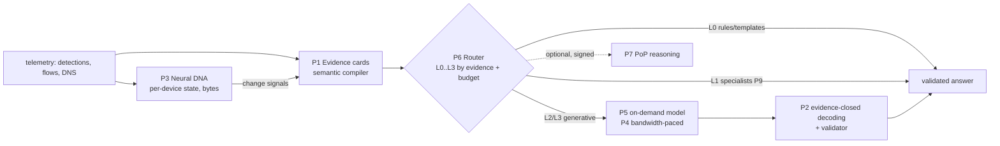

# NEURO_INNOVATION_PROPOSALS — Gate 2: original architectural opportunities

> HookProbe Neuro Engine, Research Gate 001 (2026-11-17). Each proposal states what is **new** (and
> what is prior art), its feasibility on CM5 *today* and on a future heqk, its difficulty, the metric
> that would prove or kill it, and its current evidence. "Measured here" always means **synthetic
> data on a development host** (`tools/neuro-research/`), never CM5 hardware. Scripts and raw outputs
> are in `tools/neuro-research/` and `docs/research/neuro-engine/data/`.

## Prior-art check (done before claiming novelty — read this first)

A targeted prior-art search (web: arXiv, ACL, USENIX, Google Patents; **not** a professional patent
search; GitHub search unavailable during this study) found that **none of P1–P4 is new as a
technique.** Each is at best a *novel combination of known parts* in a specific setting:

| Proposal | Closest prior art | Verdict | What may remain new |
|---|---|---|---|
| P1 evidence cards | **AIDR** (arXiv 2512.08169, Dec 2025): normalises EDR/IDS/firewall logs, keeps 3–5 high-information steps under a token budget (−68% tokens), SOAR-ready JSON. **Stratosphere Slips** "Network Event Summarization Dataset": groups events, caps summaries ~2,000 tokens for an LLM **on a Raspberry Pi 5**. Threat-hunting RAG (arXiv 2603.18196). | **already exists** | only engineering details: integer-only on a microkernel, the honest residual line, needle-preserving ranking |
| P2 evidence-closed decoding + aliases | **FullCite** (arXiv 2606.07130): citation grammar restricting cited ids to supplied documents. **Citeformer** (open source): grammar-constrained citation on vLLM/llama.cpp. Geng et al. (EMNLP 2023): input-dependent grammars. IP pseudonymisation before LLM triage: arXiv 2603.23966, Attic Security token proxy, AnonLFI 2.0. | **combination of known parts** | one alias table serving three roles at once (pseudonymisation, token saving, closed entity vocabulary) for on-device triage. **Known weakness from Attic Security:** opaque placeholders made a model *invent* a user; aliases also hide subnet/ASN context → aliases must carry kind and locality (e.g. `H` local / `R` remote, same-/24 grouping) |
| P3 guarded memory + explain-to-learn | **Cisco US 10,220,167 B2** (priority 2016): network-edge anomaly detector excludes user-confirmed anomalies from training; related Cisco patents (cold-start, user-assistance). **RAAD** (arXiv 2502.19534): analyst-marked false positives down-score similar inputs. Kitsune (NDSS 2018). Poisoning literature (Kloft & Laskov JMLR 2012; ANTIDOTE IMC 2009; "Can't Boil This Frog"). Aging-filter DNS patent US 10,938,851. Darktrace "pattern of life"; Firewalla lacks a "this is normal" action. | **combination of known parts** — expect Cisco '167 to be cited for obviousness | the *reversed default* (anomalies held out until the owner confirms them normal, not removed after being confirmed malicious), **an LLM explanation to a non-expert before confirmation**, and the signed, auditable confirmation. Gating does **not** stop slow sub-threshold poisoning |
| P4 bandwidth-budgeted decoding | **Sereno** (OSDI 2026): yields LLM decode bandwidth to foreground apps on phones, contention-reactive. **MemGuard** (RTAS 2013): per-core bandwidth reservation via PMU counters; still effective on DynamIQ Arm (RTCSA 2025). | **combination of known parts**; the arithmetic is textbook | open-loop pacing from a dense model's known bytes/token, to reserve bandwidth for a *packet data plane* on an Arm SoC without MPAM — **no prior paper found on an LLM co-located with a packet data plane on a small SoC**. Must be evaluated head-to-head against MemGuard and Sereno |

**Consequence for strategy:** HookProbe's defensible advantage is not any single mechanism — it is the
**integrated, measured system** (evidence compiler → behavioural memory → router → closed, paced,
leased generation → signed owner learning) running on a capability microkernel with admission-
controlled budgets, plus the HookProbe-specific data (eval sets, distilled specialists, calibration
data) that competitors do not have. Patent claims, if any, should be scoped to the narrow residues
above and need a professional search first.

## The thesis in one paragraph

On CM5 the scarce resources are **DRAM bandwidth** (decode), **CPU cycles** (prefill), and the
**availability of the packet path** that shares both. The conventional pipeline wastes all three:
it streams raw telemetry into a prompt (prefill cost grows with log volume), keeps a model resident
"just in case" (RAM), regenerates the same explanations for the same recurring behaviour
(bandwidth), and trusts free-form output that must then be checked. The Neuro Engine inverts the
pipeline: **compile the evidence before inference, remember behaviour without a model, invoke a
generative model only for the residue, constrain its output to the evidence, and pace it so the
data plane never notices.** None of the individual parts is exotic; the combination, designed around
a capability microkernel's admission-controlled budgets, is what is new.

---

## P1 — Evidence Cards: a semantic compiler in front of every model (Concept D)

**Idea.** Never give a model raw events. Compile a window into ranked *evidence cards*: per-entity
behavioural aggregates (fan-out, periodicity with coefficient of variation, volume, NXDOMAIN share,
label entropy), merged with the deterministic detections that reference them, ranked by severity +
novelty against the behavioural baseline (P3), with untrusted strings quoted and flagged, entities
interned, and the tail folded into one **residual line that states exactly what was omitted**
(including how many omitted cards carry detections) — so the compression is lossy but never silent.

**Prior art.** Exists — AIDR (token-budgeted alert compilation), Stratosphere Slips (≤ ~2K-token
event summaries on a Raspberry Pi 5), SIEM correlation, sketches (see the prior-art table above).
What this study adds is engineering, not invention: a recall-of-identity-**and**-magnitude test
criterion, the honest residual, and an integer-only design that fits heqk.

**Measured here (E-SC1, synthetic, 10 seeds × 60-minute windows, ~3,540 events, real Qwen3.5 tokenizer).**

| Representation | Tokens | Incident identity recall | Evidence recall |
|---|---|---|---|
| RAW rows, whole window | **~323,000** | — | — |
| RAW rows, truncated to 4,096 tokens | 4,044 | 0.03 | 0.03 |
| heqk detections only, de-duplicated | 1,834 (all) | 0.71 | 0.14 |
| Frequency top-K aggregation @ 4,096 | 3,672 | 0.00 | 0.00 |
| **Evidence cards @ 512** | **502** | **1.00** | **1.00** |
| Evidence cards @ 256 | 208 | 0.29 | 0.29 |

A ~640× reduction with full recall on this generator; a sharp knee between 256 and 512 tokens.
Detections alone identify most incidents but carry almost none of the *why* (scan breadth, beacon
period, exfil volume, NXDOMAIN burst). With llama-bpe's tokenizer the raw window is ~237,000 tokens;
conclusions are unchanged (`data/e-sc1-llama-bpe.txt`).

**Why it matters on CM5.** Prefill is compute-bound at tens to a few hundred tokens/s for 0.6–2B
models (NEURO_CM5_RESOURCE_BUDGET §4). 323K tokens is hours of prefill and gigabytes of KV; 500 tokens
is seconds and tens of MiB. **This, not the choice of model, is the largest single efficiency lever
measured in this study.**

**Caveats (honest).** The generator and the compressor were written by the same author — circularity
risk. Bugs found and fixed during the study, recorded here because they changed results:
a destination-less DNS detection was attached to every flow of the same host (≈ 50 junk cards that
pushed the injection carrier to rank 65); sub-5-second regularity was mistaken for beaconing; remote
scanners were aliased as local hosts; the residual line claimed "no detections" when omitted cards
had some; and per-line tokenisation over-counted (exact joined-prompt counting replaced it). The
real test is E-SC2: replay of public labelled traffic (CIC-IDS2017 / UNSW-NB15) and HookProbe bench
captures, scored by people who did not write the compressor.

**Difficulty:** low–medium. **Feasibility on heqk today:** yes (integer-only, bounded memory — the
detection ring is already capped at 256 rows, `mcstate.rs` `DET_CAP`).

## P2 — Evidence-closed decoding and entity interning

**Idea.** For every request, generate a JSON schema whose `evidence` field is an enum of exactly the
fact ids present (F1…Fn) and whose `entities` field is an enum of exactly the aliases present
(H1, R1, D1…). llama-server compiles the schema to a grammar, so **an invented IP, host or fact id is
not a representable output** — hallucination of entities is removed by construction, not detected
after the fact. Interning (`H5=192.168.10.18` on first use, `H5` after) cuts tokens because BPE
vocabularies spend one token per digit (an IPv4 address ≈ 13 tokens).

**Prior art.** Exists as a technique — FullCite and Citeformer restrict citations to supplied sources
by grammar; Geng et al. (EMNLP 2023) build grammars per input; IP pseudonymisation for LLM triage is
documented (table above). The HookProbe-specific step is using it as the natural extension of
ADR 0025's "barred by type, not by instruction" boundary (`RawLlmOutput` has no action field) from
*actions* to *facts*. Caveat: a closed vocabulary prevents *invented* entities, not *wrong* ones.

**Measured here.** Mechanism only: the runner builds the dynamic schema and was smoke-tested against a
mock endpoint. **Negative result on interning:** a separate legend block *lost* tokens at small
budgets (it restates every entity); inline first-use definitions are never worse than raw addresses
and save ~18% when the full card set is kept, but make no difference at the 512-token knee. Kept for
its *decoding* value (closed alias vocabulary), not its compression value.

**Open question (E-EV1):** does constraining hurt reasoning quality on small models? Published work on
constrained decoding is mixed; this must be measured per model, closed vs free mode, on the eval set.

**Difficulty:** low. **Feasibility:** today on any llama.cpp backend.

## P3 — Neural DNA: compact, guarded, evolving behavioural memory (Concept A)

**Idea.** Each device keeps a fixed-size state: hour-of-day activity, volume and fan-out profiles
(log-domain EWMA mean + deviation), the device's own learned rate of new peers, NXDOMAIN share, and
two-generation *aging* Bloom filters of peers and DNS suffixes. Scoring is surprise relative to *that
device's* learned normal — the same rule makes one new peer loud for a camera and quiet for a laptop,
with no per-device-type branches ("capabilities, not branches"). **Updates are guarded:** an
alarming hour teaches nothing; a new item becomes normal only after persisting.

**Prior art.** Kitsune (NDSS 2018); sketches (IMC 2003, UnivMon); **Cisco US 10,220,167** (excluding
confirmed anomalies from a network-edge detector's training) and RAAD (analyst feedback down-scores
similar inputs). The residue that may be new: the reversed default (held out until the *owner*
confirms normal), an LLM explanation for a non-expert *before* confirmation, and a signed record —
plus the per-device byte budget and fixed-point design for heqk.

**Measured here (E-BM1, synthetic: 60 devices × 14 days hourly; learn days 1–10, score 11–14; 5 seeds).**

| Bloom bits | State per device | Hour AUC | Detection @ 1% FPR (beacon / DGA / exfil / new service / scan) | Benign-drift alert hours |
|---|---|---|---|---|
| 256 | 254 B | 0.989 | 0.93 / 1.00 / 1.00 / 1.00 / 1.00 | 39 / 160 |
| **1024** | **638 B** | **0.999** | **1.00 / 1.00 / 1.00 / 1.00 / 1.00** | 39 / 160 |
| 16384 | 8.3 KB | 0.999 | same | 39 / 160 |

The raw history this replaces is ~1.1 MB per device (10 days, estimate) → **~1,700× smaller**. Bloom
width matters exactly where expected (256 bits saturates on chatty devices). The run *first failed*
(AUC 0.87, no new-service detection) — diagnosis showed fan-out was not diurnal, the guard let a
1.89-scoring anomaly teach the baseline, and the update policy had a **label leak** (it consulted
ground truth). All three were fixed; the leak is called out because it would have inflated results.

**The real finding is the trade-off, not the AUC.** Persistence k (alarming hours before a new item
becomes normal) trades poisoning resistance against nuisance:

| k | Hour-level detection (beacon / new service) | Incident-level detection | Benign-drift alert hours |
|---|---|---|---|
| 2 | 0.65 / 0.67 | 1.00 | 19 / 160 |
| 6 | 1.00 / 1.00 | 1.00 | 39 / 160 |
| 24 | 1.00 / 1.00 | 1.00 | 123 / 160 |

With small k an attacker's beacon *becomes normal* within hours (silent poisoning); with large k a
legitimate new SaaS app nags for days. **Proposal — explain-to-learn:** never auto-admit an item that
alarmed. Escalate it once to L2 for an explanation ("the laptop started using five new endpoints of
`<SaaS>` during work hours"), and let the **owner** confirm "learn as normal" — recorded as a signed
state update in the owner policy journal (ADR 0055). The model explains; the human decides; the state
learns only from authenticated decisions. This is the one place where generative AI and behavioural
memory multiply each other's value.

**Next (E-BM2):** a learned recurrent variant (tiny GRU / linear-RNN state per device) must **beat this
baseline at the same byte budget** on replayed real traffic, or it is rejected. **E-BM3:** fixed-point
port + heqk EL0 cost per update.

**Difficulty:** medium. **Feasibility on heqk today:** yes in fixed point (no FP/SIMD required).

## P4 — Bandwidth-budgeted decoding (availability)

**Idea.** A dense model reads ~all its weight bytes per generated token, and the GGUF tells us that
number exactly. So the engine can pace decode to a DRAM-bandwidth share: `tok/s ≤ share × BW_eff /
bytes_per_token`, adjusting `share` from data-plane pressure (drop to 0 under load, raise when idle).
E-RF1: at a 25% share a Qwen3-0.6B Q4_0 may decode ≤ 8.8 tok/s, a 1.7B ≤ 2.6 tok/s.

**Prior art.** MemGuard (RTAS 2013) regulates per-core bandwidth with PMU counters and still works on
modern Arm; Sereno (OSDI 2026) yields LLM decode bandwidth to protect phone UI. What remains is an
application: open-loop, counter-free pacing from a known bytes/token to reserve bandwidth for a
*packet data plane* on a SoC without MPAM — no prior paper on that co-location was found. It must
beat (or justify itself against) MemGuard and Sereno in E-INT2.

**Evidence:** TH. **Kill criterion (E-INT1/2):** if packet-path p99 latency is insensitive to an
unpaced decode co-runner, pacing is unnecessary complexity. If it is sensitive, measure whether pacing
restores it. **Difficulty:** low (a token-bucket in the decode loop). **Dependency:** ADR 0060 SMP +
a heqk pressure signal (ADR 0061 M9).

## P5 — Intelligence without persistent residency (Concept B)

**Idea.** The generative model holds **zero** resident RAM while idle. On a qualifying request it
leases an admitted ADR 0061 budget, loads weights from eMMC, **restores a pre-computed KV snapshot**
of its fixed prefix (system prompt + schema + few-shot examples — llama-server slot save/restore
already does this: 1,745 tokens restored in 43 ms in its README example), answers, and releases the
lease after an idle timeout. Requests are batched while warm.

**Cost (E-RF1, theoretical):** a 0.6B Q4_0 (~320 MiB) loads in ~1.1 s at 300 MB/s eMMC, 3.4 s at
100 MB/s; a 1.7B (~1.1 GiB) in 3.8–11.4 s. On Linux, `--no-repack` keeps weights evictable but forgoes
the Q4_0 repack speed-up — a trade-off to measure (E-MEM2). On heqk there is no page cache: activation
is an explicit copy into a leased budget, and the eMMC driver's sustained read rate is unmeasured.

**Answer to "can the device stay intelligent without reserving hundreds of MB for an idle LLM?" —
yes, by construction: L0, L1 and Neural DNA are always on (KB–MB), and the generative tier is a
lease.** The cost is a seconds-scale first-response latency, which suits investigations, not chat.

**Difficulty:** medium. **Evidence:** IMPL (components), TH (combination).

## P6 — Adaptive reasoning budget: route by evidence sufficiency (Concept C)

**Idea.** A request climbs levels only when the cheaper level cannot *ground* its answer, not merely
when its confidence is low:

| Level | Mechanism | Resident cost | Typical latency |
|---|---|---|---|
| L0 | heqk rules + rulecat metadata + templates (EN/RO) | 0 | µs–ms |
| L1 | Neural DNA + tiny specialists (DGA char-CNN, tabular, static embeddings) | KB–MB | ms |
| L2 | compact generative (0.6–2B) over evidence cards, closed decoding | leased | seconds |
| L3 | larger model (4–9B) on 8–16 GB SKUs, or an optional PoP | leased / remote | tens of seconds |

Escalation triggers: no rule covers the pattern; correlation across ≥ 2 cards; owner context to weigh
("this is my backup job"); a natural-language question; a Neural DNA change without a matching
detection. De-escalation: when the budget governor (P4) or RAM watermark forbids, answer at the lower
level and say so ("deeper analysis deferred: the network is busy").

**Prior art:** FrugalGPT (TMLR 2024), RouteLLM (ICLR 2025), IDK cascades (UAI 2018). New here: the
escalation signal is *evidence coverage* computed by the deterministic compiler, and the ceiling is
set by live data-plane resources.

**Measured here (E-EV0):** the L0 template backend answers verdicts on the card-shaped eval set
correctly 100% and fails every copilot question (and 44% of required explanation mentions in English).
**This number is contaminated** — the same author wrote rules and cases — and is reported only to show
the *shape*: verdicts on card-shaped input are largely already determined by heqk's deterministic
category; generative value concentrates in explanation, owner-context weighing, correlation and
language. A blind, independently written set is required (E-EV1).

## P7 — Shared intelligence across nodes without sharing data (Concept E)

**Idea.** Nodes exchange three kinds of compact, signed artefacts — never raw traffic or
conversations: (1) **behavioural signatures** (e.g. "periodic 60 s beacon to a /24 with JA4 X"),
k-anonymised (published only if seen at ≥ k tenants); (2) **specialist-model deltas** for L1 heads via
secure aggregation + clipping + DP noise + robust aggregation (FedAvg / Bonawitz CCS 2017 /
DP-FedAvg), personalised Calibre-style for non-IID sites; (3) **PoP reasoning** on request, receiving
only evidence cards with aliases, never raw addresses unless the owner opts in. Signed with heqk's
existing hybrid Ed25519 + SLH-DSA, carried on the existing PQ-hybrid control channel.

**Caution (privacy):** Bloom-filter bits of Neural DNA *can* leak membership — never ship raw DNA state;
ship only derived signatures. **Evidence:** SD (FL components), HYP (combination). **Difficulty:** high
(federation governance, poisoning). **Priority:** after a single node works.

## P8 — Compiler-generated inference for heqk (Concept F)

**Idea.** heqk cannot host llama.cpp as-is (no libc process model, no mmap, no threads API today). A
model-specific **ahead-of-time compiled executor** — static memory plan (one arena sized at build
time, so admission control is exact), fused kernels, weights in a fixed repacked layout, `no_std`
Rust + NEON dotprod intrinsics — fits a capability microkernel better than a general runtime: its
budget is known before it runs, it allocates nothing at runtime, and it is signed as one artefact.

**Prior art:** ExecuTorch AOT, TVM/MLC, IREE (no primary A76 LLM numbers found; IREE reported ~5×
slower than llama.cpp on TinyLlama CPU, secondary). **Gate:** only worth building if (a) heqk lands SMP
+ FP/SIMD + large budgets, and (b) a prototype matches ≥ 90% of llama.cpp's Linux-on-CM5 decode on the
same model. Otherwise port ggml freestanding. **Evidence:** HYP. **Difficulty:** high.

## P9 — Teacher-labelled specialist distillation for Level 1

**Idea.** HookProbe's L1 models are untrained placeholders (NAPSE tabular "seed placeholder… NOT a
trained classifier"; `dga-lm` awaiting a corpus). Use a strong **Apache-2.0** teacher (Qwen3/3.5,
Granite, Mistral 3) offline to label replayed traffic and HookProbe bench captures with rationales,
then train tiny students (logistic/GBDT on NAPSE's 16-D features; int8 char-CNN for DGA; static
embeddings for event similarity) — *distilling step-by-step* (Findings of ACL 2023), FusionLog-style
pseudo-labelling. Students run in µs–ms, integer-only, inside the Wasm host.

**Licence rule:** no Gemma (distilled students become Gemma Model Derivatives), no Llama (naming
obligations), no OpenAI/Anthropic outputs (anti-competition terms). **Evidence:** SD (method),
HYP (security transfer). **Kill criterion (E-DS1):** student must beat the current heuristic seed on a
held-out, independently labelled set.

## P10 — Native low-bit execution for the L2/L3 tier

**Idea.** For the generative tier, prefer models *trained* low-bit (BitNet b1.58 2B4T, Falcon-E,
Ternary Bonsai) executed with LUT kernels (bitnet.cpp TL1 / T-MAC), because decode bytes/token is what
CM5 lacks. T-MAC reports BitNet-3B at ~11 tok/s on Pi 5 (single-thread end-to-end comparisons vs a
2024 llama.cpp) — the only peer-reviewed low-bit number on our SoC family.

**Why it is not the default yet:** BitNet 2B4T's general quality is below Qwen-class 1.5–2B, its
context is 4K, it names no Romanian, and the comparison against *today's* repacked Q4_0 on A76 is
unmeasured. **Kill criterion (E-LB1):** on CM5-Linux, ternary must beat a Q4_0 model of equal
eval-set quality on tok/s **and** joules/answer. **Evidence:** SD + ARM (Pi 5), CM5 pending.

## Rejected or deprioritised, with reasons

| Idea | Verdict | Reason |
|---|---|---|
| Separate-draft-model speculative decoding | **reject for L2** | EACL 2026: 0.67–0.83× on 1.5–1.7B targets (GPU); on bandwidth-bound CPU the drafter's own weight traffic makes it worse [TH]. Keep prompt-lookup/n-gram drafting as a cheap experiment (E-AD2). |
| Flash/NVMe as a weight tier for decode | **reject** | 3–11 s/token for 1.7B (E-RF1); PowerInfer-class gains need ReLU-sparse models. Storage = cold tier only (P5). |
| Post-training ≤ 3-bit quantisation of 0.6–4B models | **reject** | collapses to chance-level MMLU (Qwen3 study); use native low-bit (P10) instead. |
| SparseGPT / Wanda unstructured sparsity | **reject on CPU** | GGUF is dense; no sparse kernels → no speed or RAM gain. |
| VideoCore VII GPU inference | **reject** | not supported upstream; patched path ~80× slower than CPU. |
| Early exit / LayerSkip | **defer** | needs specially trained checkpoints; none in llama.cpp. |
| One general LLM for everything | **reject as default** | most requests never need generation (P1/P3/P6); the LLM is the expensive residue handler. |
