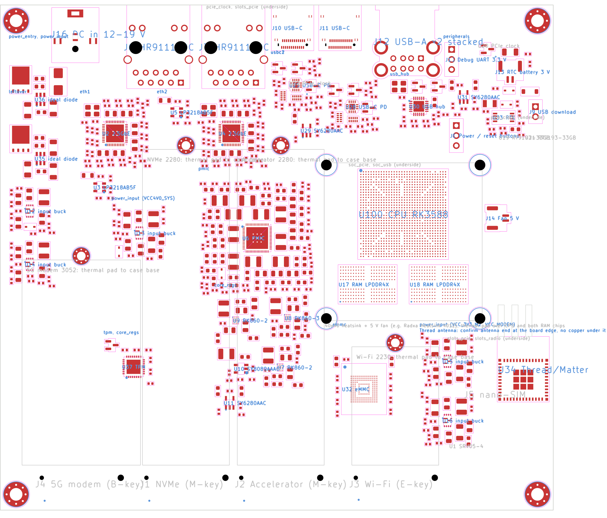

# HookProbe SBC (rev A, design in progress)

A single-board computer for HookProbe, designed chip-down around the Rockchip RK3588.
The schematic and the component placement are generated by Python scripts and checked by an
end-to-end validation script.

**Status: schematic and placement complete and validated. The board is NOT routed and has not been
built. Do not order it from these files.** See "What is not done" below.

> **Place in HookProbe OS.** This is the research design for dedicated HookProbe hardware. Direction, gates and
> the heqk port plan are in [ADR 0064](../../docs/adr/0064-open-hardware-hookprobe-board.md): CM5 must be validated
> first (H0), and heqk is ported to a Radxa ROCK 5B (same SoC/memory/power reference) before this board (H2 → H4).
> How the OS sees the board: [`appliance/hookprobe-sbc/`](../../appliance/hookprobe-sbc/). Licence: not yet chosen
> (ADR 0064 D6).



## What is on the board

| Function | Implementation |
|---|---|
| Processor | Rockchip RK3588 (8 cores, built-in NPU) |
| Memory | 2 x LPDDR4X (200-ball) |
| Storage | eMMC (153-ball) soldered, M.2 M-key slot for an NVMe SSD (2280) |
| Ethernet | 2 x 2.5 Gb, RTL8125BG, each on its own PCIe lane |
| Wi-Fi | M.2 E-key slot (2230) for a tri-band card |
| 5G | M.2 B-key slot (3052) on USB 3, nano-SIM holder |
| Thread / Matter | ESP32-H2-MINI-1 module |
| Accelerator | M.2 M-key slot (2280) for an NPU or FPGA card |
| USB | 2 x USB-C (USB 3, DisplayPort, power delivery), 2 x USB-A (USB 2.0, stacked) |
| Security | TPM 2.0 (SLB 9670), reset tied to the platform reset |
| Other | RTC with battery connector, fan header, debug serial port, power / reset header |
| Power | 12 V to 20 V on a DC jack, or USB-C port 1 (5 V at start, 20 V after negotiation) |
| Size | 140 x 128 mm, 8 layers, M3 mounting holes in the corners |

All external ports are on one edge. The processor and both memory chips sit under one 40 x 40 mm
heatsink with a fan (hole pattern of the Radxa Heatsink 4012). The four M.2 cards are on the underside,
facing the case base, so thermal pads can carry their heat into the case.

## Files

| Path | Contents |
|---|---|
| `docs/hookprobe-sbc-schematic.pdf` | Schematic, 25 sheets |
| `docs/hookprobe-sbc-placement-top.pdf`, `-bottom.pdf` | Component placement drawings |
| `docs/hookprobe-sbc-bom.csv` | Parts list, grouped by value (LCSC numbers where chosen) |
| `docs/images/` | Placement images and 3D views |
| `docs/3d/hookprobe-sbc.step` | 3D model of the board (many vendor parts have no 3D body yet) |
| `schematic/` | KiCad project: schematic sheets, board file, project-local symbol and footprint library |
| `schematic/build.py` | Generates the schematic (every part and connection is defined here) |
| `schematic/build_pcb.py` | Generates the board file: outline, holes, component placement |
| `design/power_check.py` | Power-tree check: regulator voltages, pin limits, power-up order, loads |
| `design/allocation_check.py` | High-speed interface allocation and load budget |
| `tools/board_rules.py` | Writes JLCPCB's manufacturing limits and the net classes into the project |
| `validate.py` | End-to-end validation; writes `VALIDATION.md` |
| `VALIDATION.md` | Latest validation report |

## Regenerating and checking

Needs KiCad (the scripts call `kicad-cli`) and Python 3. The files are written in the format of a KiCad 10.99
nightly build. On Linux the scripts find `kicad-cli` on `PATH` and the stock libraries under `/usr/share/kicad`;
override with `KICAD_CLI`, `KICAD_SYMBOL_DIR` and `KICAD_FOOTPRINT_DIR`. `design/allocation_check.py` needs only
Python. Vendor datasheets (`vendor/*/datasheet.pdf`) are not in the repository; download them from LCSC.

```bash
python3 schematic/build.py          # schematic
python3 schematic/build_pcb.py      # board file with placement
python3 tools/board_rules.py        # manufacturing limits and net classes
python3 validate.py                 # full check, about ten minutes
```

The latest run passed 90 of 90 checks: the KiCad netlist matches the intended connections, the
electrical rules check is clean, every schematic pin reaches the right pad on the board, the board
check shows no errors under JLCPCB's published limits, and the power tree is within every chip's
datasheet limits.

## What is not done

- **Routing.** No tracks, no planes. This is the largest remaining task and needs a layout engineer
  with RK3588 / LPDDR4X experience, followed by signal- and power-integrity review.
- **Stack-up and impedance.** Track widths for PCIe, USB and Ethernet pairs are computed starting
  values, to be replaced with the manufacturer's figures.
- **Parts still to confirm:** a 2.5 Gb-rated Ethernet jack (the placed one is rated 1 Gb), the
  ideal-diode transistors, the ESD substitutes, the enable-clamp zener.
- **Assumptions still to confirm:** PCIe lane mapping, M.2 socket orientation, Thread antenna
  direction, memory placement against Rockchip's layout template.
- **Input over-voltage:** the input converters' absolute maximum is 26 V. Use 20 V or less.
- **USB-C power** depends on the bootloader negotiating 20 V, as on the Radxa ROCK 5B.
- Silkscreen clean-up, test points, assembly files, prototype bring-up, compliance testing.

An independent review by a design house or by Rockchip's field engineers is strongly recommended
before any money is spent on manufacturing.

## Reference design

Large parts of the processor, memory and power circuits follow the published Radxa ROCK 5B v1.45
schematic. The reference schematic and the component datasheets are not included in this repository;
download them from their owners.
